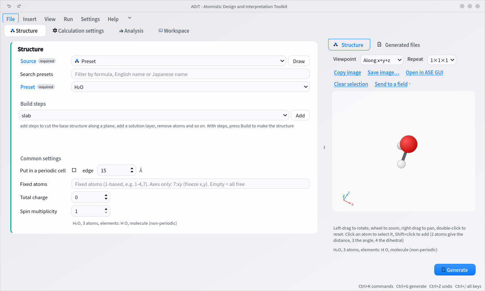
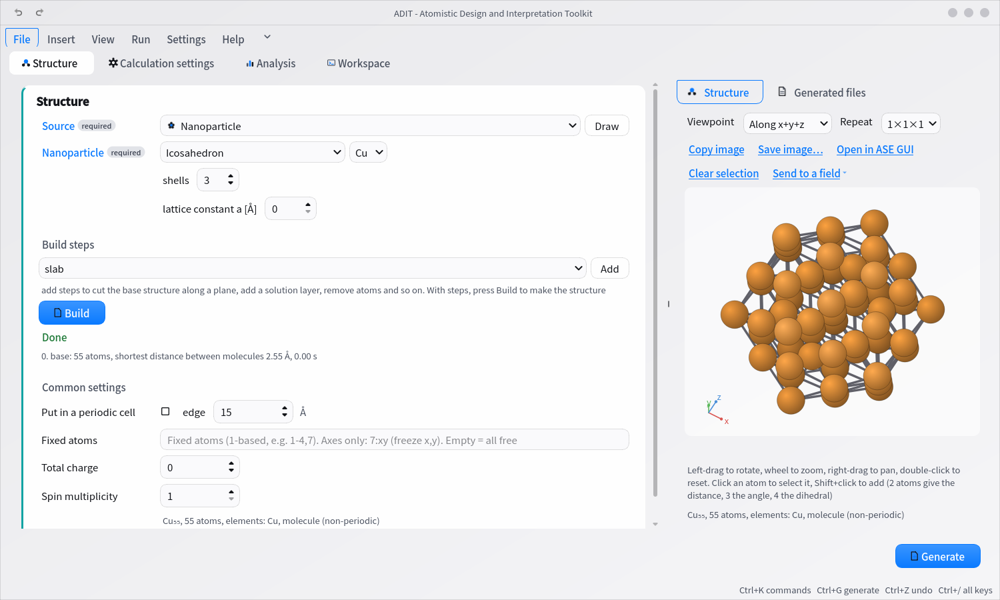
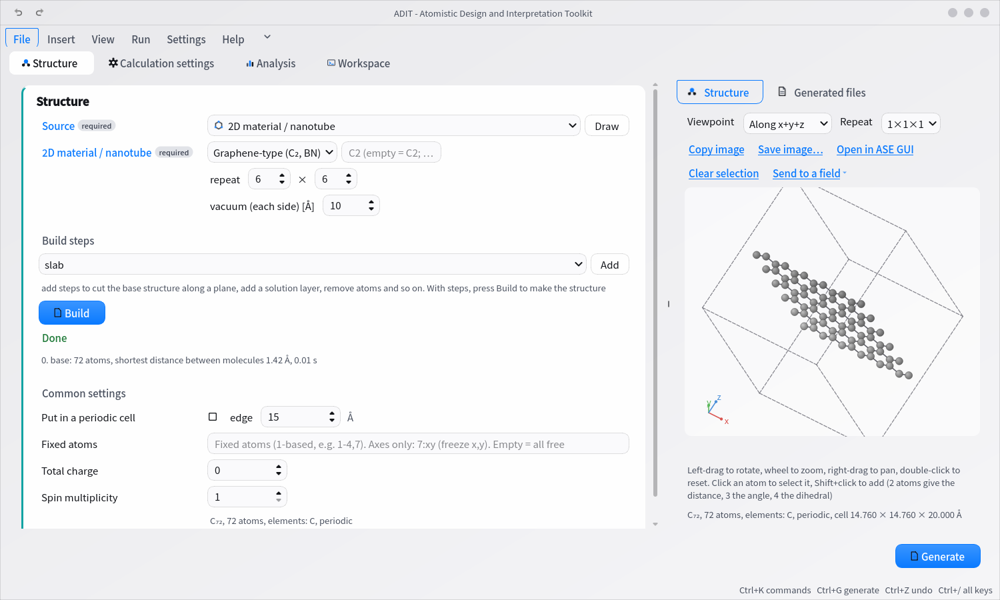
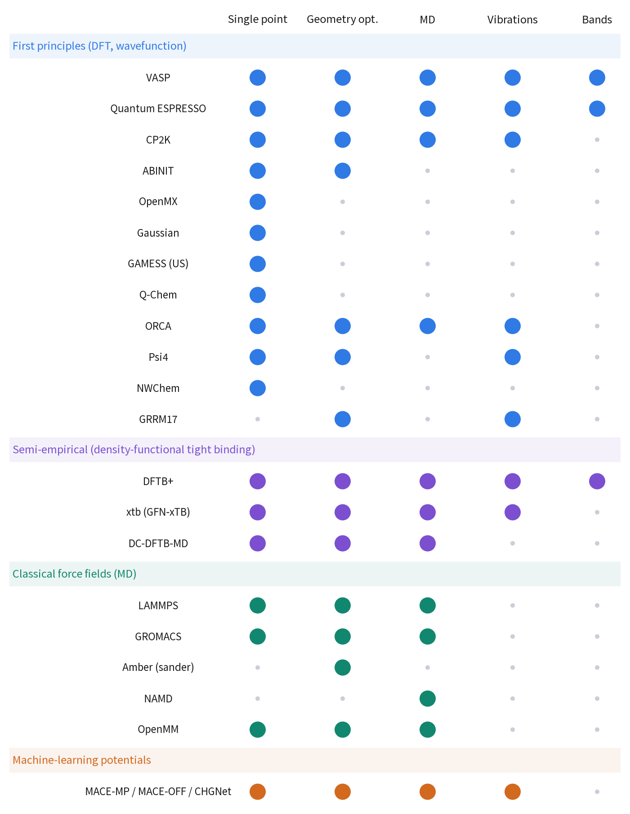
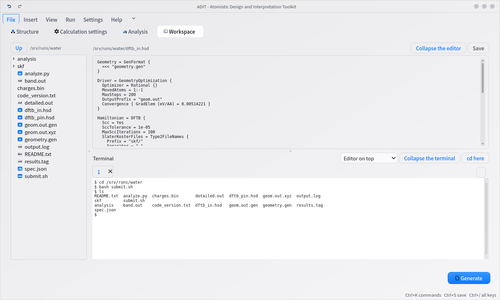

# ADIT

**Atomistic Design and Interpretation Toolkit** — a desktop app that takes computational chemistry
calculations **from building the structure to analyzing the results, all through the GUI**.

[](https://github.com/adit-chem-project/adit-chem/actions/workflows/tests.yml)
[](https://pypi.org/project/adit-chem/)
[](https://pypi.org/project/adit-chem/)
[](LICENSE)



With ADIT, you can do all of the following in one app.

- **Build structures** — molecules, crystals, surfaces, solutions, nanoparticles, polymers. You can also draw them
- **Choose a calculation code (a program such as DFTB+ or VASP) and the settings, and the full set of files for the run is generated automatically**
- **Use the terminal built into the app** — connect to a compute server with `ssh` and submit from there
- **Analyze results into figures and tables** — ready to paste into papers and slides

Everything a computational experiment needs is in this one app, so **you don't have to jump between several programs.**

ADIT is meant for people who are not yet comfortable with programming tools.
Even a fourth-year undergraduate who has just joined a lab and has yet to type a command
can prepare and analyze calculations by following the screen.
(Only submitting to the compute server takes typed commands in the terminal, which is good practice too.)

---

## Installation

**Windows** — Download `ADIT-windows-x64.zip` from [Releases](https://github.com/adit-chem-project/adit-chem/releases),
extract it, and start `ADIT.exe`.
If SmartScreen warns you on first launch, choose "More info" → "Run anyway".

**macOS** — Download `ADIT-arm64.zip` from the same place. The first time only, right-click the app in Finder and choose "Open".

**Linux, or if you want to manage your own environment**

```bash
git clone https://github.com/adit-chem-project/adit-chem.git
cd adit-chem && pip install -e ".[gui,smiles,analysis]"
adit
```

The interface starts in English. To switch to Japanese or between light and dark, use **Settings** in the ribbon. The change applies at once. See the [settings file](docs/SETTINGS.md) for `language` and `theme`.

You need to get the calculation codes (DFTB+, VASP, Quantum ESPRESSO and others) and their parameters (Slater-Koster, pseudopotentials, POTCAR)
separately. The detailed steps are in [Installation for each OS](docs/INSTALL.md).

**To learn how to use ADIT, see the [tutorial](docs/USAGE.md).** It follows a water geometry optimization from start to finish, with screenshots.

## Features

### Building structures

Molecules (from presets, from SMILES, or hand-drawn with Draw), bulk crystals, surface slabs, solutions and mixtures,
2D materials and nanotubes, nanoparticles, polymers. You can rotate the result in 3D with the mouse to check it.

| Nanoparticle | 2D material |
|---|---|
|  |  |

You can stack editing steps such as cutting along a plane, adding a solution layer, removing atoms, and adsorbing molecules,
so even a structure like an electrode-electrolyte interface can be built on screen.

### Creating input files

ADIT supports 21 calculation codes. Nine can be chosen from the dropdown on screen (DFTB+, VASP, xtb, Quantum ESPRESSO, ORCA, CP2K, LAMMPS, GROMACS, and machine-learning potentials).
For the rest, write the settings in `spec.json` and generate with `adit-gen` ([supported software](docs/SOFTWARE.md)).



ADIT writes the input files, `submit.sh` for running them, `README.txt` with instructions for running,
`spec.json` with the saved settings (load it to recreate the same input), and `analyze.py` for analysis.
For a cluster, it also writes `transfer_and_submit.sh` with the transfer and submit commands.

### Working with files and the terminal

The **Workspace** tab has a file tree, an editor and a terminal. You can touch up input files,
organize files, and connect to a cluster with `ssh`, all without switching screens.



### Analyzing results

Energy and temperature, RDF, MSD and diffusion coefficients, density of states, band structures, frequencies and spectra (IR and Raman).
Coordination numbers, the structure factor S(q), hydrogen bonds, Voronoi, solvent-accessible surface area, free-energy surfaces and more: over 60 analysis methods in all.


In the analysis **summary**, each value comes with the name of the file and the line number it was read from
(both in the Analysis tab and in the exported `analysis/summary.txt`). You can trace any number you copied later on.

```
atomic charges (Mulliken, detailed.out:18, in e): O1 -0.613, H2 +0.282, H3 +0.331 (sum +0.0000); table in analysis/charges_Mulliken.csv
```

### Figures for papers and slides

Structural formulas, 3D views and analysis figures can be exported as SVG, PNG and MOL.
You can also copy an image to the clipboard and paste it straight into Word, for example.
Line colors, tick direction, grid lines and frames can be set and saved, so you can also meet a journal's requirements.

### Keeping a record of calculations

**You can keep the settings and results of a calculation as a record, exactly as they are.** This helps in situations like these
(only what is on record is written out; items with no record are marked "Not on record").

| What you want to do | Item on screen | What you get |
|---|---|---|
| Write the "Methods" section of a paper | Methods section (Markdown) | Calculation code and its version, functional, basis set, k-points |
| Show calculations with different settings together | Conditions table (CSV) | One row per calculation. Five runs at different temperatures give 5 rows |
| Check results at a glance | Results table (CSV) | Final energy, average temperature, frame count, whether the run ended normally |
| Hand a full set of calculations to someone else | Reproducibility bundle (.zip) | Input files + **calculation code versions** + **the actual pseudopotential and similar files** + SHA-256 |
| Check whether input files were edited by hand | Verify the input fingerprints | Differences between the SHA-256 recorded in `spec.json` and the actual files (same / changed / missing) |

See [Reporting calculation settings](docs/REPORT.md) for details.

## Documentation

| Document | Contents |
|---|---|
| [Installation for each OS](docs/INSTALL.md) | Windows / macOS / Linux. Also how to build the executables |
| [Tutorial](docs/USAGE.md) | With images. Building structures, creating input files, running, analysis |
| [Screen guide](docs/SCREENS.md) | What each field specifies |
| [Supported software](docs/SOFTWARE.md) | For each calculation code, the supported calculations and their scope |
| [Settings](docs/SETTINGS.md) | Locations of calculation codes, cluster profiles |
| [Analysis details](docs/ANALYSIS.md) | What each analysis method does and its conditions |
| [Heavy analysis](docs/HEAVY_ANALYSIS.md) | Processing large trajectories on a compute server |
| [Python API](docs/API.md) | Using ADIT as a library |

## License

ADIT is released under the [MIT License](LICENSE).
Third-party files in `examples/` and `tests/data/` keep their original licenses; see [THIRD_PARTY_NOTICES.md](THIRD_PARTY_NOTICES.md).
