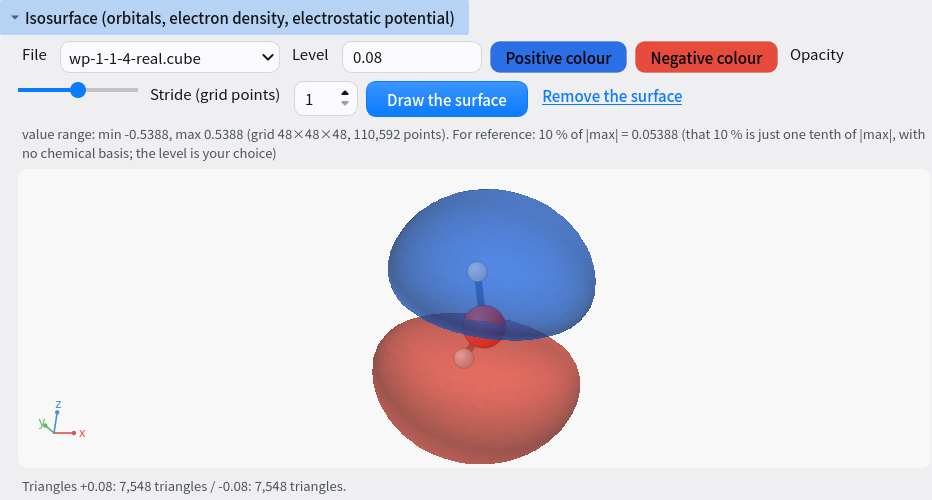

# Analysis details

This page describes the items you can choose in the Analysis tab and in the `adit-analyze` command.
Settings are described in [Settings](SETTINGS.md).

## Analysis

Run `analyze.py` in an output directory after the calculation (`python analyze.py --rdf --msd --dos`). It writes plots (PNG) and a summary (summary.txt / summary.json) to `analysis/`.
The "Analysis" tab of the GUI, the "Analysis" page of the web version and `adit-analyze` all do the same work. ADIT does not judge whether the numbers are good or bad.

| Analysis | Files read | Output |
|---|---|---|
| Energy and temperature vs. time | DFTB+ md.out / output.log; xtb xtb.trj (energy) and the MD table in output.log (temperature, written at the screen-output interval, which is separate from the trajectory dump interval); VASP vasprun.xml and OSZICAR; pw.x output.log; ORCA output.log (energy only, temperature is not read) | Line plot |
| Radial distribution function (RDF) | Trajectory (geo_end.xyz, xtb.trj, vasprun.xml / XDATCAR, pw.x output.log, ORCA trajectory.xyz) | g(r) for each element pair |
| Mean squared displacement (MSD) and diffusion coefficient | Same as above (in periodic systems, moves across a boundary are corrected) | MSD plot and D [cm²/s], by default from a linear fit over 10-50 % of the maximum lag time |
| Density of states (DOS) | DFTB+ band.out and the Fermi level in detailed.out; VASP DOSCAR | DFTB+ eigenvalues are broadened with Gaussians (width `--sigma`, default 0.1 eV). DOSCAR values on its grid are used as they are, without further broadening (with ISPIN = 2, the sum of spin up and spin down) |
| Frequencies and spectrum | DFTB+ hessian.out (diagonalization of the mass-weighted Hessian), xtb vibspectrum, VASP OUTCAR, ORCA output.log | List of frequencies and the spectrum (weighted by IR intensity when available) |
| Bond lengths | Final structure | Atom pairs within 1.2 times the sum of their covalent radii |
| Band structure | `bands/kpath.json` with DFTB+ band.out, pw.x output.log or VASP EIGENVAL | Band plot with high-symmetry point labels, and the smallest gap across the Fermi level. If a band crosses the Fermi level, the system is metallic (gap 0 eV; no VBM, CBM or effective masses are given). Spin polarization (SPIN 2 in band.out, ISPIN = 2 in EIGENVAL, SPIN UP / SPIN DOWN in pw.x) is drawn in two colors, and the gap is judged over both spins |
| Atomic charges | DFTB+ detailed.out, xtb xtbout.json, CP2K output.log (Mulliken, Hirshfeld) | Table per atom, with the charge definition and its source (file:line) |
| Thermochemistry (values from the code) | output.log of xtb and ORCA | ZPE, H, G and so on, as printed (with line numbers) |
| Thermochemistry (computed with ASE) | Frequencies and the final structure | Ideal gas, harmonic, quasi-harmonic and quasi-RRHO. The user supplies the temperature and other inputs (there are no defaults; if anything is missing, nothing is computed and the reason is given). thermo.csv |
| HOMO-LUMO gap and dipole | xtb xtbout.json and others | Value and source |
| Time-series statistics | MD temperature, energy, density and pressure | Error of the mean from block averaging (blocking.png), integrated autocorrelation time |
| Coordination number n(r) | Same trajectory as the RDF | coordination.png, n and n_reverse in rdf.json |
| Density profile along z | Trajectory of a periodic system | Number density and mass density per element (zdensity.png / zdensity.json) |
| Pressure | LAMMPS log.lammps, GROMACS energy table | pressure.png |
| Diffusion coefficient per element | Same trajectory as the MSD | D [cm²/s] per element (the fit range can be set). With `--select`, only the selected atoms are counted (the intersection with `--msd ELEMENT`). If the requested element is not in the trajectory, no D is given and a note lists the elements that are present |
| Structure factor S(q) | Same trajectory as the RDF (`--rdf --sq`, periodic systems only) | S(q) for each element pair (sq.png / sq.json). Faber–Ziman form, integrating g(r) up to rmax (number density of all atoms, Lorch window). q < 2π/rmax is affected by the finite integration range |
| NEB | VASP image directories (00, 01, …), QE neb.x .dat / .int, CP2K BAND output.log | Energy curve (neb.png) and barrier. For CP2K, image values only |
| PDOS | VASP DOSCAR, QE projwfc.x *.pdos_atm#… | pdos.png / pdos.csv |
| UV-Vis | ORCA TD-DFT absorption table | Table of transitions (uvvis_transitions.csv) and the broadened spectrum (uvvis.png) |
| Space group | Final structure (when spglib is installed) | Space group for each tolerance |
| Phonon dispersion and DOS | phonopy band.yaml and total_dos.dat | phonon_bands.png, phonon_dos.png |
| Comparison table | Several calculation directories (plus thermochemistry if each has analysis/thermo.csv) | ΣνE, composition balance, items whose settings differ (compare_*.csv, compare_energy.png). ΔH, ΔS and ΔG when every run has an ASE thermochemistry table (only when temperature and pressure match) |
| Hydrogen-bond lifetime | MD trajectory and the distance and angle of `--hbond` | Presence autocorrelation C(τ) (intermittent / continuous), integral and 1/e times (hbond_lifetime.png / .csv) |
| Hydrogen-bond distance-angle map | MD trajectory (upper distance from `--hbond-cdf`) | 2D histogram of D–A distance × D–H···A angle (hbond_map.png / .csv). No thresholds are chosen |
| CREST conformers | crest_conformers.xyz (total energy [Eh] on the comment lines), crest.energies, the last table of crest.log (degeneracy) | Relative energy per conformer (kcal/mol, kJ/mol, eV), degeneracy, heavy-atom RMSD to the lowest conformer. Boltzmann weights only when a temperature is given (crest_conformers.csv, crest_conformers.png) |
| Warnings and failure signs in output logs | Log of each code (output.log, log.lammps, OUTCAR, md.log and others) and the job scheduler output in the same directory (`*.o<number>`, `slurm-*.out`) | Number of warnings and the first 3 (file:line and text), and candidate causes of failure (unconverged SCF or geometry optimization, time limit, out of memory, abnormal MPI exit, diagonalization failure, LAMMPS Lost atoms, GROMACS LINCS and others). Shown from line 2 of the summary and in `tables.diagnostics` of `summary.json`. Supported codes are DFTB+, VASP, Quantum ESPRESSO, xtb, ORCA, CP2K, LAMMPS and GROMACS (for others, only the time limit, memory and MPI signs) |

Main options of `adit-analyze` (`adit-analyze --help-all` lists them all):

| Option | Meaning |
|---|---|
| `--stride N` | Use every N-th frame of the trajectory (thins out large trajectories; affects RDF, MSD, z density and export) |
| `--skip N` | Discard the first N frames as equilibration. When a temperature, energy or pressure series is written at a different interval from the trajectory (LAMMPS thermo and dump, VASP OSZICAR and NBLOCK, and so on), the same time (N × the time of one frame) is discarded |
| `--msd-fit T0 T1` | Time range [fs] for fitting the diffusion coefficient (default 10-50 % of the maximum lag time). When given, the block error also uses the same absolute range for all blocks |
| `--select EXPR` | Atom selection (`element O`, `index 1-10`, `z < 10`, `within 5 of index 3`, and / or / not). Affects MSD (including D per element and per atom), the displacement distribution, VACF, RMSD and RMSF. The number of atoms used appears in the summary |
| `--sq` | Compute the structure factor S(q) from the RDF (needs `--rdf`; periodic systems only) |
| `--zdens [Å]` | Density profile along z (a number after the option sets the bin width; default 0.2 Å; periodic systems only) |
| `--export` | Write the trajectory to `analysis/export/` (extxyz, xyz, pdb; VMD view.vmd and vmd_load.tcl; OVITO ovito_pipeline.py; TRAVIS answer files travis_*.in; export_README.txt. See "Exported files" below) |
| `--unwrap-molecules` | Make molecules whole across periodic boundaries before writing (implies `--export`) |
| `--memory-mb MB` | Memory limit for holding coordinates in MSD (default 1024). A larger trajectory is not read: ADIT stops and suggests a stride |
| `--compare [SET]` | Comparison table. `"ads=1:slab_mol,-1:slab,-1:mol"` (coefficient:directory; separate reactions with `;`). If omitted, compare.json is read |
| `--thermo MODEL` and others | Thermochemistry (ASE). Give `--temperature` `--pressure` `--symmetry-number` `--geometry` `--spin` `--imaginary` `--exclude-lowest` `--qh-cutoff` `--msrrho-tau` to suit the model |
| `--uvvis SHAPE:FWHM` | Shape and full width at half maximum [eV] for broadening the ORCA UV-Vis spectrum (e.g. `gauss:0.3`) |
| `--pdos` | Also write the reason when PDOS files are absent (if they exist, the plot is drawn without this option) |
| `--symprec Å[,Å…]` | Space-group tolerance (the default lists 1e-5, 1e-3 and 1e-1) |
| `--hbond 3.5,150` | Number of hydrogen bonds (distance [Å] and angle [degrees] are required; there are no defaults) |
| `--hbond-lifetime` | Hydrogen-bond lifetime (presence autocorrelation; needs `--hbond`) |
| `--hbond-cdf Å` | 2D distribution of D–A distance × D–H···A angle (pass the upper distance) |
| `--conformer-temperature K` | Temperature for the Boltzmann weights of the CREST conformers. If omitted, only relative energies are given (there is no default temperature) |

```bash
adit-analyze out/md --msd --stride 10 --msd-fit 1000 5000 --zdens 0.5
adit-analyze out/md --export --unwrap-molecules
adit-analyze out/vib --thermo ideal_gas --temperature 298.15 --pressure 100000 --symmetry-number 2 --geometry nonlinear --spin 0
adit-analyze runs/ --compare "ads=1:slab_mol,-1:slab,-1:mol"
adit-analyze out/conformers/crest --conformer-temperature 298.15
```

### Play in 3D (trajectory, optimization steps, vibrational modes)

When you press "Run analysis" in the Analysis tab, a "Play in 3D" box appears below the summary. The "Analysis" page of the web version also plays trajectories (at most 200 frames are sent to the browser, and the rest are thinned out; vibrational-mode playback is desktop only). `adit-analyze` has no playback.

- **Trajectory and steps**: ADIT reads the same frames the analysis reads (DFTB+ geo_end.xyz, xtb xtb.trj / xtbopt.log, VASP vasprun.xml / XDATCAR, pw.x output.log, ORCA trajectory.xyz, LAMMPS, GROMACS and CP2K trajectories, and others), applying "Frames to skip as equilibration" and "Stride (every N-th frame)" from "More options". If the data would exceed the memory limit (default 1024 MB, the same as `--memory-mb`), ADIT automatically applies a stride that fits and says so below the box.
  The frame number is shown, along with the time [fs] when the time step is known. The plot below shows energy (and temperature for MD) over time, and a vertical line follows the frame. When the number of energy points differs from the number of frames, the line position is scaled proportionally and a note says so.
- **Vibrational modes**: ADIT reads the frequencies and the displacement direction of each atom from the output of a supported code, and moves the atoms back and forth along the selected mode. The amplitude field ("Amplitude (largest atom motion)") is the displacement [Å] of the atom that moves most (ADIT attaches no meaning to the number). The plot below lists the frequencies. A vertical line marks the selected mode, and clicking jumps to the nearest mode.

| Code | Files read | Notes |
|---|---|---|
| DFTB+ | hessian.out and the final structure | Eigenvectors of the mass-weighted Hessian. Translations and rotations are not removed, so modes near 0 also appear |
| xtb | g98.out | Gaussian 98 format written by xtb |
| Gaussian | Frequencies / Atom AN tables in the output log | HPModes format (one line per coordinate) is not supported |
| ORCA | VIBRATIONAL FREQUENCIES and NORMAL MODES in output.log | Translations and rotations with frequency 0 and zero displacement are removed |

For codes not listed above (VASP, Quantum ESPRESSO, CP2K and others), frequencies may be readable but playback is not supported. A note says "mode display supports DFTB+ (hessian.out), xtb (g98.out), Gaussian, ORCA".

### Isosurfaces (orbitals, electron density, electrostatic potential)



If a result directory contains volumetric data (cube, CHGCAR, PARCHG, LOCPOT, CHG), an "Isosurface" box appears below the summary in the Analysis tab (the "Analysis" page of the web version has the same box). Choose a file, enter an isovalue in "Level" and press "Draw the surface" (in the web version, "Show"). The surface at that value is triangulated and drawn semi-transparently over the atoms. The 3D view controls (rotation, zoom, atom selection, distance and angle measurement) work as usual.

- **The isovalue has no default.** Choosing a file shows the minimum and maximum values and "10 % of |max|", but this 10 % is just one tenth of the value and has no chemical basis. The user decides which surface to look at.
- With a positive isovalue, files that contain negative values (the real part of an orbital, for example) also get the surface at -isovalue, drawn in the "Negative colour". With a negative isovalue, only that surface is drawn.
- Values and units are as in the file (cube values as written; CHGCAR and PARCHG are converted to e/ų, LOCPOT to eV). Coordinates are in Å.
- Periodic grids are joined across the cell boundary so that the surface closes. These are VASP files and pp.x cube files (pp.x writes the whole FFT grid without end points; such files are recognized by `Cubefile created from PWScf calculation` on line 1). Other cube files are drawn only inside the written box.
- The number of triangles has a limit (20,000 on the desktop, 60,000 in the browser). If the estimate exceeds it, nothing is drawn and ADIT suggests a "Stride (grid points)" value that fits (one button sets it). A stride keeps 1 of every n grid points, so the surface becomes coarser.
- The surface is built with marching tetrahedra (each grid cube is split into 6 tetrahedra and the surface is cut from each one, using the cases of PolygoniseTri in P. Bourke, "Polygonising a scalar field", https://paulbourke.net/geometry/polygonise/). It needs only numpy. Normals come from the gradient of the grid values.
- Only one grid is read per file (the format that puts several orbitals into one cube cannot be read; write out one orbital at a time).

How to make each code write volumetric data (see each code's documentation for details):

| Code | Setting | File written | Source |
|---|---|---|---|
| Quantum ESPRESSO | `output_format = 6` in `&PLOT` of `pp.x` (`plot_num` selects density, potential or orbital) | The cube named by `fileout` | INPUT_PP (quantum-espresso.org/Doc/INPUT_PP.html) |
| DFTB+ | `waveplot` (needs eigenvec.out written with `WriteEigenvectors = Yes` and the basis wfc file) | `wp-<kpoint>-<spin>-<level>-real.cube` / `-abs2.cube`, total charge `wp-abs2.cube` | waveplot chapter of DFTB+ recipes (dftbplus-recipes.readthedocs.io) |
| VASP | `LPARD = .TRUE.` with `IBAND` / `EINT` / `KPUSE` (split with `LSEPB`, `LSEPK`). With `LPARD` alone, the valence density is written to CHGCAR | PARCHG (`PARCHG.<band>.<k>`) | LPARD in the VASP Wiki |
| xtb | `density=true` / `spin density=true` in xcontrol (the input file), or `--fod` (check the block to write in the xtb docs) | `density.cub` / `fod.cub` | Properties chapter of the xtb docs (xtb-docs.readthedocs.io) |
| ORCA | Write orbitals, density or electrostatic potential to a Gaussian cube with the interactive menu of `orca_plot` | `<basename>.mo<n><a/b>.cube` and others | orca_plot section of the ORCA manual (check the format number in the manual) |

Cube files written by the "3D number-density grid" of `adit-analyze` can also be viewed in this box.

### Hydrogen-bond lifetime and the distance × angle distribution

For hydrogen bonds counted with `--hbond DISTANCE,ANGLE` (pairs of hydrogen i and acceptor j), ADIT follows the presence h_ij(t) in each frame (1 if the criteria are met,
0 otherwise). `--hbond-lifetime` computes the autocorrelation below (t0 runs over all frames, and only those with N(t0) > 0 enter the average).

    C(τ) = ⟨ Σ_ij h_ij(t0) h_ij(t0+τ) / Σ_ij h_ij(t0) ⟩_t0

- intermittent: pairs that broke and re-formed are also counted at t0+τ (h_ij(t0) h_ij(t0+τ) as is)
- continuous: only pairs that never broke between t0 and t0+τ are counted (the product h_ij(t0) h_ij(t0+1) … h_ij(t0+τ))

The definition follows `HydrogenBondAnalysis.lifetime` and `lib.correlations.autocorrelation` in MDAnalysis
(https://docs.mdanalysis.org/stable/documentation_pages/analysis/hydrogenbonds.html: "S(τ) = ⟨ N(t0, t0+τ) / N(t0) ⟩",
"intermittency 0 is continuous"). The intermittent case corresponds to intermittency = ∞.
As in MDAnalysis, pairs are distinguished as hydrogen-acceptor pairs.
As the lifetime, the table gives the integral of C(τ) (truncated at τ_max = half the number of frames; a lower bound if C has not decayed to 0) and the τ at which C falls below 1/e.
No exponential fit is done. Time is in fs if the time per frame is known, otherwise in frames.
Memory (frames × pairs, 1 byte each) is estimated first. If it exceeds the `--memory-mb` limit, nothing is computed and a stride is suggested.

`--hbond-cdf MAX` gives a plot for examining the basis of the thresholds. It takes all D–H···A combinations (H is assigned to the nearest N / O / F within 1.3 Å)
with D–A within the upper limit, and builds a 2D histogram (60 × 60 bins) of D–A distance (0 to the limit) × D–H···A angle (0 to 180 degrees).
The density is divided by area and normalized to 1 overall. If `--hbond` gives a distance and an angle, they are overlaid as dashed lines. The user chooses the thresholds.

### Reaction ΔH, ΔS and ΔG (comparison table)

When each calculation directory has `analysis/thermo.csv` (the thermochemistry table written by ASE with `--thermo`; failing that,
`thermo_ase` in `analysis/summary.json`), the comparison table sums the following with coefficients ν.

    ΔH = Σ ν_i H_i      ΔS = Σ ν_i S_i      ΔG = Σ ν_i G_i      (H_i = E_i + H_corr,i, G_i = E_i + G_corr,i, E_i is the final energy from the output)

- These are given only when all runs in the set have rows at the same temperature (and pressure). Otherwise the table says "the temperatures do not match (298.15 / 300)" and gives no values
- Ideal gas (`ideal_gas`) gives H, S and G. Harmonic, quasi-harmonic and quasi-RRHO models have no H, so only ΔS and ΔF (F = U − TS) are given, and the G column is labeled F.
  Sets that mix ideal-gas and vibrations-only models are not reported
- The columns in `compare_reactions.csv` are `thermo_T_K`, `delta_h_ev` / `delta_h_kj_mol`, `delta_s_ev_per_k` / `delta_s_j_mol_k`,
  `delta_g_ev` / `delta_g_kj_mol`, `delta_g_label` (G or F) and `thermo_note`. Multiple temperatures are listed with `;`.
  `compare_summary.json` has `thermo` (a list of dictionaries, one per temperature) and `thermo_note` for each reaction
- Unit conversions: 1 eV = 96.485332123 kJ/mol = 23.060547830619 kcal/mol, 1 eV/K = 96485.33212 J/(mol K)
- The per-reaction table on screen ("Compare runs…" on the desktop, `/compare` on the web) shows the same columns

### Reading CREST conformers and their weights

Running the `crest/run_crest.sh` written by `adit-gen --conformers` leaves the CREST results in that location.
Pass that directory (or its parent, the directory of the conformer set) to `adit-analyze`, and it reads the following.

- `crest_conformers.xyz`: conformers with duplicates removed. The comment line of each structure holds the total energy [Eh] (written with `f18.8` by `cregen.f90` in CREST)
- `crest.energies`: `index  E − E(lowest) [kcal/mol]` (also from `cregen.f90`; copied as is to the `crest_energies_kcal_mol` column of the table)
- The `degen` column of the last table in `crest.log` (`Erel/kcal  Etot  weight/tot  conformer  set  degen`): the degeneracy g of each conformer (the number of rotamers).
  If the table is absent, all are taken as 1 and a note says so

Relative energies come from the total energies on the comment lines (or from `crest.energies` if those are absent), and are listed in kcal/mol, kJ/mol and eV.
RMSD is from a Kabsch superposition of the heavy atoms onto the lowest conformer (number 1). Permutations of symmetric atoms are not considered.

Weights are given only when a temperature T is entered with `--conformer-temperature` (on screen, "Temperature for the CREST conformer weights [K]").

    w_i = g_i exp(−ΔE_i / k_B T) / Σ_j g_j exp(−ΔE_j / k_B T)      ΔE_i = E_i − E(lowest), k_B = 8.617333262e-5 eV/K

There is no default temperature (CREST itself reports `weight/tot` at 298.15 K, but ADIT does not copy that value).
Sources: the CREST documentation (the sample output at https://crest-lab.github.io/crest-docs/page/examples/example_1.html) and
`src/cregen.f90` in its source (the `crest.energies` format `(2x,i0,2x,f12.3)` and the comment-line format `(2x,f18.8)`).
ADIT cannot yet sum vibrations or UV-Vis spectra computed in separate directories for each conformer with these weights
(no information links CREST conformers to ADIT calculation directories).

On screen, opening "More options" in the Analysis tab (on the web, the Analysis page) gives the same fields as the options above (stride, MSD fit range,
density profile along z, time-series statistics, the thermochemistry fields, UV-Vis broadening, space-group tolerances). The thermochemistry fields have no default values.
Results appear below the summary as tables ("Atomic charges", "Thermochemistry", "Electronic structure", "Time-series statistics", "Trajectory", "Diffusion coefficients", "Space group", "UV-Vis transitions") and plots. Click a table's heading to collapse it.
Long tables show only the first 20 lines, with the location of the full file.

- The output-log scan only looks for strings that each code actually writes (for example, `SCC is NOT converged` in DFTB+, `convergence NOT achieved` in pw.x, `SCF run NOT converged` in CP2K, `Lost atoms` in LAMMPS) and scheduler and MPI strings (`DUE TO TIME LIMIT` in Slurm, `=>> PBS: job killed: walltime` in PBS, `MPI_ABORT was invoked`). It copies the lines it finds as they are and sorts them into candidate causes. It does not judge quality or remedies.
  Remedies are copied, with source URLs, from each code's documentation and FAQ and from the aiida-quantumespresso implementation into the section "What the documents suggest when a run fails" at the end of the generated `README.txt` (these are not recommendations from ADIT).
- When a trajectory is too large and the analysis stops, ADIT shows the reason and a "Set the stride to N" button. Pressing it puts N into the stride field, and you then press "Run analysis" again
- For the MSD, moves across periodic boundaries are recovered from the minimum image. If a move between adjacent frames (after the stride) reaches 40 % or more of the shortest cell width, it is close to half a cell width, where the direction can no longer be recovered uniquely, so a caution is left in the summary and in `summary.json`.
- D in the MSD comes from a linear fit over the given time range. The indicative error uses D per block. By default, each block is fitted over 10-50 % of its own maximum lag time (the range for each block is written to `D_error.blocks` in `summary.json` and to the summary). Only when a range is given with `--msd-fit` do all blocks use the same absolute range, and if any block cannot contain it, no error is given. The indicative error is the standard error of the mean of the block D values. It is not a rigorous error of the D from the whole trajectory.
- Coordination number, Steinhardt q4/q6, clusters and the bond-angle distribution (`--coordination` `--steinhardt` `--clusters` `--adf`) count all periodic images with the ASE neighbor list. They give correct values even for small cells narrower than twice the cutoff (such as the 4-atom FCC cell). The RDF still goes up to half the cell width, as before.
- MD with a DFTB+ Barostat (NPT) uses `Lattice vectors (A)` in md.out as the cell of each frame. For trajectories with a changing cell, the MSD counts boundary crossings in fractional coordinates and converts back to Cartesian coordinates with the cell of each frame (the same as xu in LAMMPS). Motion carried by the box expansion and contraction also enters the MSD, and the summary says so.
- When thermochemistry (ASE) chooses the modes to use from the 3N frequencies, it takes them in order of decreasing |frequency| (imaginary modes count by absolute value, so an imaginary mode stays among the modes used, and the `--imaginary` branch takes effect). If a mode below 50 cm⁻¹ remains among those used, a caution is written. Quasi-harmonic (`quasi_harmonic`) and quasi-RRHO (`msrrho`) need ASE 3.28 or later (with an older ASE, nothing is computed and the reason is given).
- "Export for TRAVIS, VMD and OVITO" writes to `analysis/export/` and displays the contents of export_README.txt.
  On the desktop, "Open the export folder" opens the file manager (the web version only shows the location)
- "Compare runs…" takes the directories to compare and their coefficients, one per row (a row with an empty name belongs to the same reaction as the row above).
  The desktop version uses a small window and the web version a separate page (`/compare`). If the base directory has compare.json, it can be loaded

### Exported files for TRAVIS, OVITO and VMD

`--export` writes the following to `analysis/export/`. **ADIT has not run any of them** (TRAVIS, OVITO and VMD are assumed not to be available locally).
Templates contain no numerical values. They use `<...>` holes or examples with their source.

| File | Contents | How it was checked |
|---|---|---|
| `trajectory.extxyz` / `.xyz` / `.pdb` | Trajectory (the cell in extxyz, CRYST1 for each frame in pdb) | A test reads them back with ASE |
| `view.vmd` | VMD loading and cell (minimal) | A test compares the strings |
| `vmd_load.tcl` | VMD loading plus typical display settings: all atoms as CPK, `--select` atoms as VDW, white background, orthographic projection. DynamicBonds and image rendering are examples (commented out) | Command names and arguments compared with the VMD User's Guide (mol / color / display / axes / render) and the PBCTools documentation |
| `ovito_pipeline.py` | Radial distribution function and coordination number (run section), followed by **commented-out templates**: structure identification (CNA / PTM / Ackland-Jones), Wigner-Seitz defect analysis (reference structure is `<...>`), displacement vectors and atomic strain, cluster analysis, spatial binning + time averaging, selection by expression | Class and argument names compared with the OVITO 3.16 Python reference (`ovito.modifiers`) |
| `travis_rdf.in` / `travis_cdf.in` / `travis_msd.in` / `travis_hbond.in` / `travis_acf.in` | Answer files to pass to TRAVIS with `-i`. They cover the cell size [pm] and the choice of function | Format (one answer per line, empty line = default, `!` = comment) checked against the TRAVIS Quick Start Guide and source. **The order of the questions was read from the source and has not been verified by running** |
| `export_README.txt` | The explanation above, and a guide to the remaining TRAVIS questions (time step, choice of molecules and atoms, frame range) | — |

TRAVIS answer files are written only for **orthorhombic fixed cells** (for non-orthorhombic cells the advanced-mode procedure has not been checked; for nonperiodic systems TRAVIS asks for the cell, so you answer by hand).
When the file runs out, TRAVIS switches to keyboard input, so you can answer the rest interactively. As the official guidance suggests, the reliable approach is to run once without `-i` and reuse the `input.txt` that TRAVIS writes.
In TRAVIS, the velocity autocorrelation function is named `acf` (not `vacf`).

A `--select` expression (`element O and z < 10` and so on) is rewritten as a VMD selection in `vmd_load.tcl` (`name O and z < 10`; indices start at 0),
and as an OVITO expression in `ovito_pipeline.py` (`ParticleType == "O" && Position.Z < 10`). `within` cannot be rewritten as an OVITO expression, and the file says so.

## Convergence tests and lattice constants (parameter scan)

Results of plane-wave DFT (VASP, Quantum ESPRESSO) depend on numerical settings as well as on the chemical setup.
The main ones are the **cutoff energy** (how finely the electron waves are represented; `ecutwfc` in QE, `ENCUT` in VASP) and the **k-points** (how many points represent the electronic states in the crystal).
Too small a value gives a wrong answer, and too large a value inflates the computation time. So you raise the value and look for the point where the energy barely changes. This is a convergence test.
Listing energies while changing the lattice size in small steps also gives the equilibrium lattice constant and the bulk modulus (how hard the material is to compress).

ADIT creates inputs that differ in a single setting, one directory per value, and after you run them, turns the results into a table and a plot.

**From the GUI**

1. Choose the structure and calculation settings as usual.
2. In the "Run" menu, open "Generate a parameter scan…". Enter the item to change ("Cutoff energy" / "k-point mesh" / "k-point density" / "Lattice size" / "Other") and the values (comma-separated), then press "Generate".
3. Run each resulting directory (on this PC, `bash submit.sh` in each directory; on a cluster, as jobs. Run large systems on a cluster).
4. When all are done, press "Run analysis" in the Analysis tab (the directory field already holds the output location).

**From the command line**

```bash
adit-gen spec.json out/ --scan method.ecutwfc=30,40,50,60     # QE cutoff [Ry]
adit-gen spec.json out/ --scan kpoints.mesh=4x4x4,6x6x6,8x8x8  # k-point mesh
adit-gen spec.json out/ --scan scale=0.97,0.98,0.99,1.00,1.01,1.02,1.03   # lattice size (periodic systems)

# after running each one
adit-analyze out/ --scan
```

**Reading the table and plots** (`out/scan_energies.csv`, `out/scan_energy.png`; for lattice size, also `out/eos.png` and `out/eos.json`)

| Column | Meaning |
|---|---|
| Diff. from last [meV/atom] | Difference from the energy of the last value written (usually the finest setting), divided by the number of atoms. Only for lattice size is it "Diff. from minimum", with the lowest-energy scale factor set to 0 |
| Max force [eV/Å], Pressure [GPa] | Values for the final structure (only when readable from DFTB+, QE or VASP output) |
| Equation-of-state fit | Only when the lattice size is varied over 5 or more points. The Birch–Murnaghan equation gives the equilibrium volume, the bulk modulus, the scale factor at the energy minimum and the lattice lengths at that factor |

What value counts as good enough depends on the purpose of the calculation, so ADIT does not judge it.
A common target is about 1 meV per atom. Calculations that look at differences, such as reaction energies, can often be looser. Calculations that use forces or stresses (lattice constants, vibrations) need to be tighter.

**Things to watch**

- Usually you fix the cutoff first and then the k-points.
- If `ecutrho` (the charge-density cutoff) in QE is 0 (not set), pw.x uses 4 times `ecutwfc`. Ultrasoft and PAW pseudopotentials may need a larger value.
- In VASP calculations that change the volume (lattice-size scans or lattice relaxation), a low cutoff produces a spurious stress (Pulay stress) and lattice constants that come out too small. An `ENCUT` about 30 % above the POTCAR default is often recommended.
- Metals converge slowly with k-points, so choose the occupation broadening (smearing) and its width together with them.
- The number of calculations grows with the number of values.

## Web version

```bash
adit-web --open        # http://127.0.0.1:8765/
```

The web version offers the same generation and analysis as the desktop version, through forms in a browser. "Preview" shows the contents of the generated files, and "Generate" writes them to an output directory on the server (the PC running `adit-web`).
The "Analysis" page analyzes a result directory and shows the plots and summary on that page. Under the summary, "Play in 3D" moves through a trajectory or optimization steps with a slider and a play button (a vertical line in the small energy and temperature plots follows the frame, and clicking jumps to that frame). If the directory has a cube or CHGCAR, an "Isosurface" box also appears, and entering an isovalue overlays the surface on the atoms (at most 60,000 triangles are sent to the browser). You can also load and download spec.json (if a loaded file has keys that match no field, the names of the ignored keys are shown).
In the "Structure (3D)" picture, click an atom to select it (Shift+click to add). Two atoms show a distance, three an angle and four a dihedral (periodic systems use the nearest image). "To the fixed-atoms field" adds the selected indices to the fixed-atoms field. For fields on the Analysis page, paste the displayed indices.
Opening the page with the "Go to analysis" link or a `/analysis?dir=…` URL does not run the analysis (the fields are filled in, and a notice says "The analysis has not been run yet").
Plots are made only when you press "Run analysis".

The only dependencies are the Python standard library and Jinja2. By default it listens only on 127.0.0.1.
Requests whose destination (Host) is not an address of `adit-web` itself (127.0.0.1, localhost, or this PC's host name or IP address, with the port used at startup), and requests sent from another site (Origin / Referer other than `adit-web`), are refused with 403 (this stops other pages open in the browser from acting without your intent). When opening through SSH port forwarding, use the same local port number as on the server (for example `ssh -L 8765:127.0.0.1:8765 <host>`).
The screen state (the form being edited, the preview, the analysis plots) exists once per `adit-web` process, so use it from one browser at a time.

If you start it on an address that other PCs can reach, such as `--host 0.0.0.0`, a token is created at each startup and printed in the terminal in the form `http://…:8765/?token=…`. Once you open this URL, that browser can keep using the server without the token. You can set the token yourself with `--token` (allowed characters are alphanumerics, `_` and `-`), or remove it with `--no-token`. Traffic is not encrypted, so use this only inside a trusted network, such as a campus network.

- The URL with the token stays in the browser history. On a shared PC, clear the history when you are done.
- Restarting `adit-web` changes the token, and the previous URL no longer opens (unless the token was set with `--token`).
- Traffic is not encrypted (http). The token also travels in plain text.
- Starting with `--host 0.0.0.0` (all addresses) prints two lines: a URL for yourself and a URL for other PCs. `--host ::` also listens on IPv6.

For developers (running the tests, adding a calculation code), see [CONTRIBUTING.md](../CONTRIBUTING.md).
