# Screen reference

This page walks through the desktop and web screens from top to bottom:
structure sources, calculation settings, then the features that generate many calculations at once.

**If you are new, start with the [tutorial](USAGE.md).** This page explains what each field on the screen sets.

## Screen layout

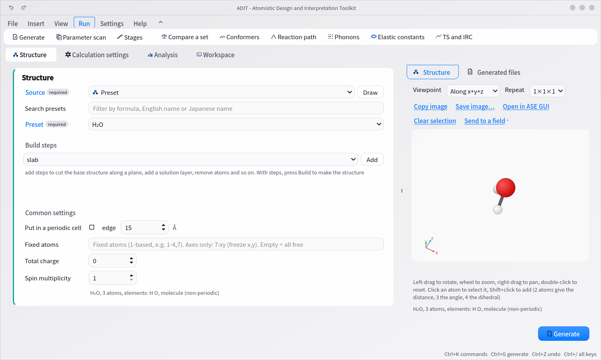

- **Progress and empty areas**: "Build" and "Run analysis" run in the background. Under 1 second, nothing appears. Past 1 second, a progress bar and "Cancel" appear. Past 10 seconds, the display changes to a percentage and an estimate of the time remaining (solution packing counts molecules; build steps count steps). An area with nothing in it yet (the Workspace editor, the analysis results, Generated files when generation is not possible, the parameter scan screen) shows a heading, a one-line explanation and the next button to click
- **Command palette** (Ctrl+K): Search for actions, fields and presets by name, then run them or jump to the field. Japanese and English both work (for example "temperature", "generate", "water"). Hover over a button to see its shortcut in the form "Generate (Ctrl+G)". Ctrl+/ opens the list of all shortcuts
- **Ribbon** (the same style as Word): Click a heading, and its buttons appear below in groups. File (open or save the calculation settings spec.json, Continue, templates, Convert, Inspect inputs/results, Quit); Insert (Draw: draw a molecule, load a structure file, add a component to the solution); View (the right-side tabs); Run (Generate, Parameter scan, Stages, Batch generation: Compare a set, Conformers, Reaction path, Phonons, Elastic constants, TS and IRC); Settings (Preferences, language, theme, window frame); Help (command palette, keyboard shortcuts, README, About ADIT). The ribbon starts collapsed, with only the row of headings visible. Click a heading and its buttons appear in one row. Click a button and the ribbon collapses again. To keep it open, click the ˅ button to the right of the headings or press Ctrl+F1 (do it again to collapse). The collapsed or open state is saved as `ribbon_collapsed` in the preferences, and the next session starts the same way
- **Top edge**: At the left of the title bar are small "Undo / Redo" buttons (settings history, Ctrl+Z / Ctrl+Shift+Z). Below that is the row of ribbon headings, and below that a switch between "Structure", "Calculation settings", "Analysis" and "Workspace". The left side of the screen changes to match
- **Left side** (on "Calculation settings"): It has two columns. The left column has "Task", "k-points (periodic)" and "Execution target and resources"; the right column has the "Method" group (one column when the window is narrow). On "Structure", it shows the structure source and build step groups
- **Right-side tabs**: Structure (a 3D view you can rotate with the mouse; select atoms to measure distances and angles and send them to fields) and Generated files (a preview; when generation is not possible, the reason and a "Go to the field" button). On "Workspace" these are hidden, and the whole screen is used for files, the editor and the terminal
- **Lower right**: The "Generate" button (Ctrl+G). It writes the full set of inputs to the output directory and moves the Workspace terminal there. When generation is not possible, a red badge such as "2 issues" appears to its left. Click the badge to open the full list. Select a row to jump to that field. A field with a problem gets a red border and one line of red text under it giving the reason (both disappear once you fix it)
- **Status line at the bottom**: On the left is the status (how many files were generated and what to do next; for 10 seconds after an overwrite, "Undo"). On the right are the keys available now (Ctrl+K commands, Ctrl+G generate, Ctrl+Z undo, Ctrl+/ all keys; on Workspace, Ctrl+S save). Hover over a label or input field, and its description appears on the left

Blue labels tagged "required" are required fields. Black labels are optional fields with a default. Initial values are either the code's own default or "Not set". For a field where ADIT does set a value, the description gives its source (the official documentation). A field changed from its default (the default in spec.json, which is the code's own default) gets a thin blue line to the left of its label (a gray line for a value loaded from a template). Right-click a label and choose "Reset to default (code default: 200)" to reset only that field. "Changed only" at the upper right of "Calculation settings" shows only the changed fields (and the code). Hover over a label or input field to see a short description of what it sets, in a tooltip and at the bottom of the screen.

### Structure sources

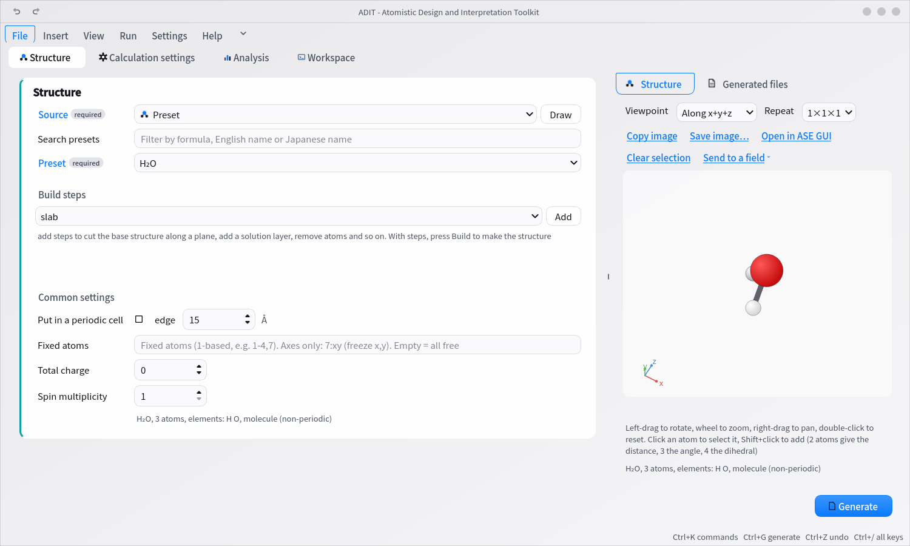

| Source | Description |
|---|---|
| Preset | Choose a molecule by name from those included in ASE (the G2 set and others) |
| SMILES | RDKit builds a 3D structure from the string. You can also draw the molecule with the "Draw" button |
| File | Any structure file ASE can read (xyz, cif, POSCAR, gen and so on) |
| Bulk | Builds a unit cell from an element and a crystal structure (fcc, bcc, diamond and so on) |
| Slab | Cuts a surface slab from a surface index (fcc111 and so on), an element, a layer count and a vacuum layer |
| Fetch from a database | Fetches a structure from PubChem, COD, Materials Project or OPTIMADE by name or ID (goes online only when you click "Fetch") |
| Solution / mixture | Takes several molecules and ions by count and packs them into a cubic periodic cell set by density or edge length (see below) |
| 2D material / nanotube | Graphene-type (C₂, BN), MX₂ sheet (MoS₂ and others), nanoribbon, nanotube. Adds vacuum in the nonperiodic directions |
| Nanoparticle | Icosahedral, decahedral, octahedral and Wulff-shape (from surface energies) nanoparticles. These structures are not periodic |
| Polymer | One chain, made by joining a repeat unit given as SMILES (with two `*` at the joining positions, for example `*CC*`) as many times as the degree of polymerization (up to 500 atoms including H). Click "Build" to make it |

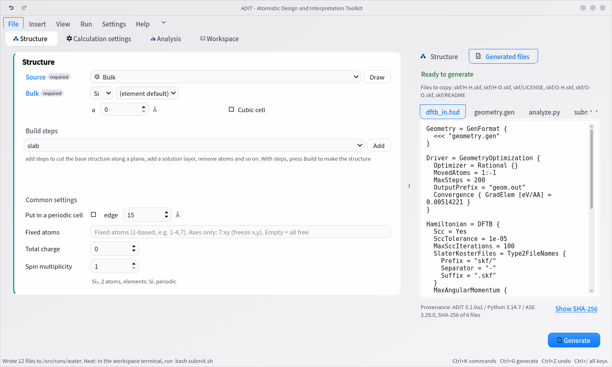

The common settings cover putting a molecule in a periodic cell (needed for VASP and pw.x), fixed atoms, total charge and spin multiplicity.

**Build steps**: In the "Build steps" part of the structure group, you can stack operations from top to bottom on a base (a structure made with one of the sources above). Choose a step type from the drop-down and click "Add". Reorder the list with "Up", "Down" and "Remove". Select a row to show that step's fields below. Clear a row's checkbox to skip the step without deleting it (spec.json records `"enabled": false`). Use this to test what happens without a step.

| Step | Description |
|---|---|
| slab | Cuts the current bulk into a slab along any Miller-index (h k l) plane. Sets the number of layers, the vacuum (one side) and which atomic plane is on top (the termination; the composition of the atomic planes in one period is listed) |
| solvent layer (interface) | Places a solution layer with the same cross-section on top of the slab (an electrode-electrolyte interface). Components work as in the solution table. Thickness comes from the density or is set directly. Also sets the gap to the slab, the vacuum on top (0 means solution on both sides), the minimum distance and the random seed. "Count from concentration" fills in the count of the row (ion) selected in the table from a concentration [mol/L] |
| fix | Fixes atoms chosen by the bottom n layers, a z range or an element. When a fix step exists, the "Fixed atoms" field in the common settings is not used (the step takes priority) |
| supercell | Repeats along each axis, or a 3×3 integer transformation matrix |
| remove / substitute | Randomly removes or replaces a count or fraction of the atoms selected by element and z range (vacancies, delithiation, doping). A random seed makes the result reproducible |
| adsorb | Places one molecule (preset / SMILES / file) at a named adsorption site, directly above an atom, or at xy coordinates, with a chosen height and the atom facing down |
| vacuum / box / solvate | Vacuum along an axis; a rectangular box (padding for a molecule, re-cut to an orthogonal cell for a crystal); filling with solvent without moving the solute |

When build steps exist, the structure is not rebuilt each time a field changes. Click "Build" to build it in the background. (Solution packing takes a few seconds and a polymer up to about 20 seconds. The screen stays responsive while it runs, and "Cancel" discards the result.) ADIT then shows the atom count per step and the minimum distance between molecules. On failure, the message reads "step k (name): …" with the reason, and that step's row is selected. The total charge starts as the sum of the component charges (if adsorption or substitution changes the charge, edit the field). spec.json stores the base and the steps as they are, and opening it brings them back on screen (the saved atomic coordinates are used, with no rebuild). For a file base, ADIT records the SHA-256 of the file's contents. If the file has changed, it stops the rebuild and tells you.

**Example: an electrode-electrolyte interface** (an electrode slab plus a C₃H₄O₃ and LiPF₆ electrolyte, no vacuum, solution on both sides of the slab): Set the source to "File" and choose the slab's structure file (or "Bulk" to start from a bulk). In the step drop-down, choose "Electrode–electrolyte interface (surface cut + auto-sized cross-section + solution + fixed layer)" and click "Add". This adds, in order: a surface cut (omitted if the base is already a slab), a supercell that widens the cross-section to fit the solution, a solution layer (three rows: C₃H₄O₃ = SMILES `O=C1OCCO1`, Li⁺ = `[Li+]`, PF₆⁻ = `F[P-](F)(F)(F)(F)F`; vacuum 0), and a fix step (the bottom layer). The supercell raises the repeat counts along a and b until no component overlaps its own periodic image. The repeat counts shown are lower bounds. The counts and density are examples, so enter your own conditions. (Ion counts can also come from "Count from concentration". When thickness comes from the density, the band volume depends on the total mass, so after setting the anion row, click "Fill selected row" once more on the cation row.) Finally, click "Build".

Depending on the counts and density you give, packing can fail and stop. The slab gap `gap` does not change the thickness of the solution band, so check the band width and minimum distance shown in the packing failure message. The random seed also changes the initial arrangement.

**Solution / mixture**: List the components (preset / SMILES / file) in the table with their counts and charges. The "Molecule" column changes with the component kind. A preset is chosen from the list of molecules (formulas such as H₂O), a SMILES string is typed in the field or drawn with that row's "Draw", and a file is chosen with "Browse…". The cell size is set by density [g/cm³] or edge length [Å]. You can also set the minimum distance between molecules and the random seed. The concentration [mol/L] of each component and the total charge (the sum of the component charges) are shown. Packing uses only ASE and numpy (no packmol or the like). It places the molecules on a lattice and then pushes apart those that are too close, so it reaches liquid densities such as 1 g/cm³ for water. Molecules move as rigid bodies, so their shapes do not change, and they are not cut at the cell boundary. The same seed reproduces the same structure from spec.json. The web version and the command line take one component per line (`H2O * 32`, `smiles:[Na+] * 1 charge=+1 label=Na+`, `file:ion.xyz * 2`).

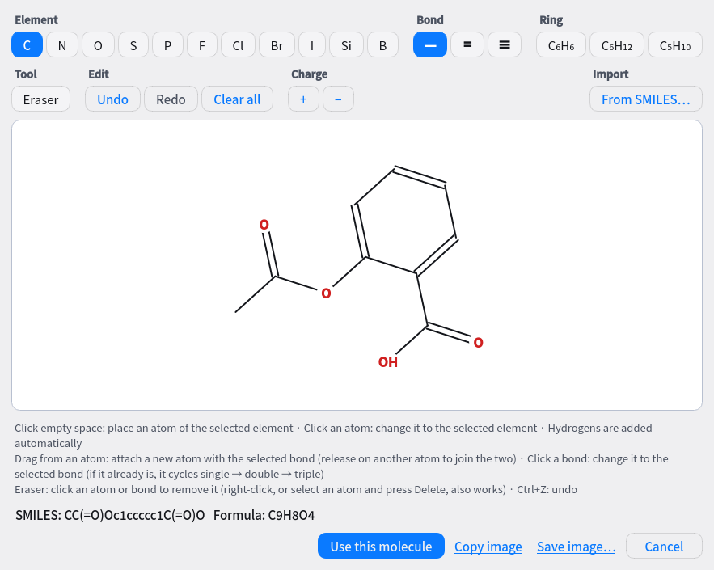

**Draw**: The "Draw" button in the structure source (or "Insert" on the ribbon, or "Draw" in the solution table) opens the molecule drawing screen (requires RDKit).
Choose an element and click to place an atom. Drag from an atom to extend a bond. With a bond tool (single, double or triple), dragging from one atom to another joins them with a bond of that order (to join CH3 to a C6H6 ring, for example).
Clicking a bond changes its order, and the eraser removes atoms or bonds (Ctrl+Z undoes). There are also ring templates (C6H6, C6H12, C5H10) and +/− for charge. Hydrogens are added automatically. The molecule you draw is converted to SMILES and a 3D structure is generated.

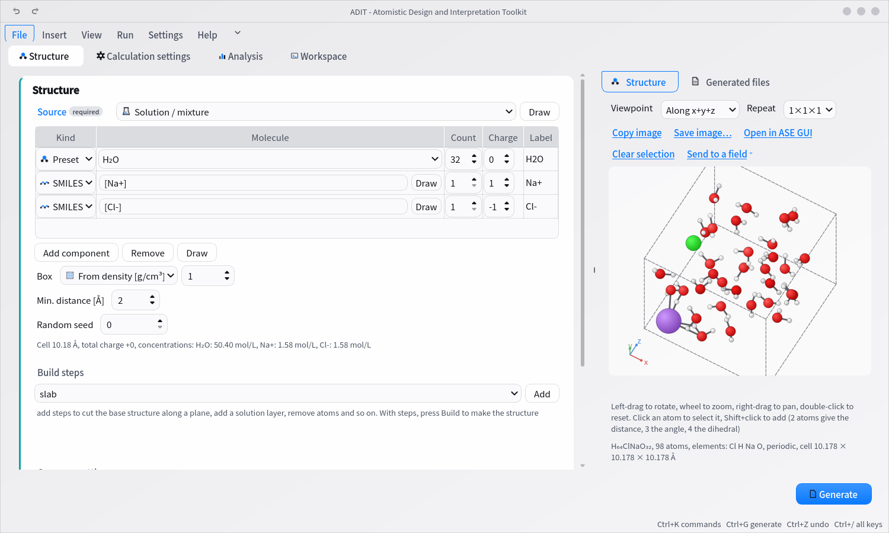

**Fetch from a database**: Set the source to "Fetch from a database", choose where to fetch from (PubChem / COD / Materials Project / OPTIMADE), enter a name or ID, and click "Fetch". ADIT goes online only when you click this button, not at startup or when a field changes.

| Database | What to enter | What comes back | Data terms (checked on each site, retrieved 2026-09-19) |
|---|---|---|---|
| PubChem | A compound name (for example `water`) or CID (for example `962`) | SDF of the 3D conformer (a compound with no 3D conformer stops with "cannot fetch") | NCBI policy: information created by the US government is public domain. A provider (submitter) may attach other terms |
| COD | A COD ID (for example `1000041`) | CIF | CC0 1.0 (dedicated to the public domain) |
| Materials Project | An mp-ID (for example `mp-149`). Needs `mp_api_key` in the preferences | Structure (JSON, written out as extxyz) | CC BY 4.0 (requires attribution to Materials Project) |
| OPTIMADE | A composition (for example `SiO2`) or `database:ID` (for example `oqmd:4061352`). A filter such as `elements HAS ALL "Si","O"` also works as is | Collects candidates across all registered providers, then returns the structure of the one you choose (JSON, written out as extxyz) | Follows each provider's terms (ADIT records the provider's page) |

When a name or composition has several candidates, a list appears and you choose which to use (ADIT does not decide). A fetched structure comes in by the same path as "File", so the 3D view, build steps and saving to spec.json all work as they do for a file. The fetched file is placed in `~/adit_runs/fetched/` and also copied to the generated output directory. The source, ID, date and time, SHA-256 of the response and license are recorded in `provenance.fetched_structure` in spec.json and in README.txt.

The web version works the same way. Under "Source", "Fetch from a database" has a drop-down for the database, a name/ID field and a "Fetch" button. When there are several candidates, a "Candidates" drop-down appears. Choose one and click "Fetch" again.

### Measure in the 3D view and send atoms to fields

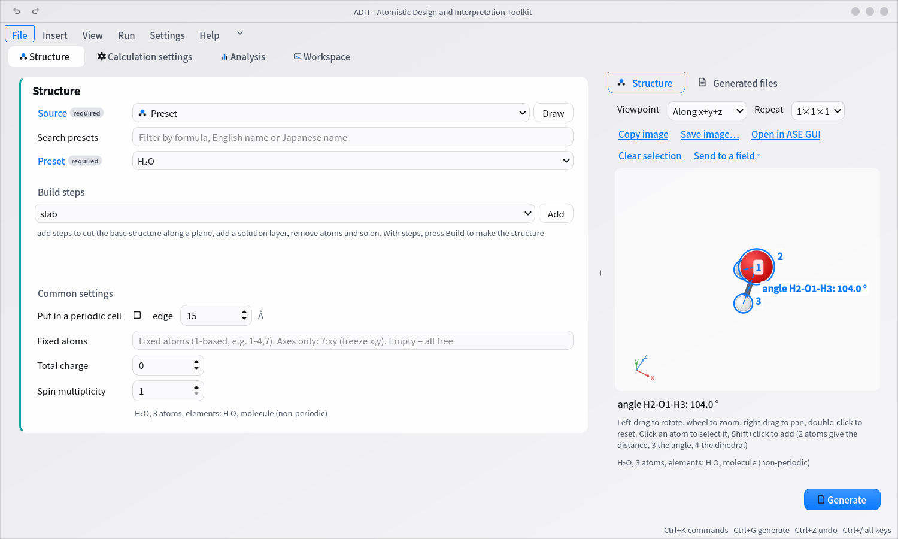

In the 3D view on the right-side "Structure" tab, click an atom to select it (Shift+click to add, Shift+click again to remove, click an empty spot to clear).
Select 2 atoms for the distance [Å], 3 for the angle [degrees] (with the second atom as the vertex), and 4 for the dihedral [degrees]. The value appears on the picture and in the row below it.
In periodic systems, the distance is to the nearest image (even with a repeat count such as 2×2×2).

"Send to a field" enters the numbers of the selected atoms (starting from 1) in one of these fields.

| Destination | Format | Use |
|---|---|---|
| The fixed-atoms field | `1-2,7` (merged with the numbers already there and re-sorted; axis specifications such as `7:xy` are kept) | Atoms that should not move in a geometry optimization or MD |
| "Atom selection" in analysis | `index 1,3` (if another expression is there, `… or index 1,3`) | RDF, MSD, coordination number and so on for only some atoms |
| The series fields in analysis | 2 atoms go to the distance field, 3 to the angle field, 4 to the dihedral field, as `2,1,3` (in click order) | Time evolution of bond lengths or angles |

In a periodic system displayed with repeats, numbers are mapped back to the base cell (selecting two images of the same atom shows a message saying so).

"Structure (3D)" in the web version measures the same way. (The only destination there is the fixed-atoms field. For the fields on the analysis page, paste the numbers shown.)

### Preparing calculations: solvents, magnetism and DFT+U, continuing a calculation, stages, group templates

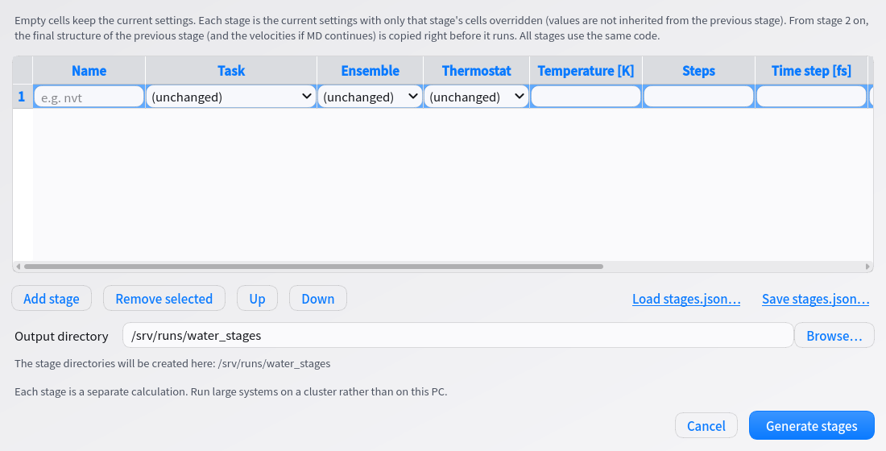

ADIT does not recommend solvents, U values or how to arrange stages. Field defaults are the code's own default or "Not set".

**Solvent** (in the "Method" group):

| Code | Fields | What is written |
|---|---|---|
| xtb | Solvation model (None / ALPB / GBSA) and solvent | `--alpb <solvent>` / `--gbsa <solvent>`. The solvent choices are only the names xtb accepts for that model and method (GFN1 / GFN2 / GFN-FF). Not available with GFN0-xTB |
| ORCA | Solvation model (None / CPCM / SMD) and solvent | `! CPCM(<solvent>)` / `! SMD(<solvent>)`. The choices come from the solvent table in the ORCA 6.1 manual |
| DFTB+ | Solvation parameter file (GBSA) | `Solvation = GeneralisedBorn { ParamFile }`. Give a file named like `param_gbsa_<solvent>.txt`. Molecules (nonperiodic) only |
| CP2K | Solvent permittivity (SCCS) | `RELATIVE_PERMITTIVITY` in `&SCCS`. 0 means no solvent |

**Per-element initial magnetic moments and DFT+U** (VASP, Quantum ESPRESSO, CP2K): There are per-element fields (for VASP, MAGMOM expanded in POSCAR atom order; for QE, `starting_magnetization`; for CP2K, `MAGNETIZATION` in KIND; empty means not specified) and a DFT+U table (each row has an element, shell, U [eV] and J [eV]). The table offers only the elements in the current structure, and U has no default. The formalism is chosen with LDAUTYPE in VASP, the HUBBARD projector in QE (the QE generator does not write J, so there is no J column) and PLUS_U_METHOD in CP2K.

**Continuing a previous calculation**: On the ribbon, choose "File" → "Continue" and pick a directory that ADIT generated and that has been run. A calculation that starts from its final structure (and velocities, for MD) is loaded on screen, with a list of what is and is not carried over. Clear "Carry over the velocities (when both runs are MD)" to create new initial velocities. Check "Use the current settings for the conditions (untick for the previous run's conditions)" to take only the structure (and velocities) from the previous calculation.

| Code | What an MD continuation carries over |
|---|---|
| DFTB+, VASP | Positions and velocities |
| xtb | Positions and `mdrestart` (coordinates and velocities) |
| CP2K | Positions, cell and restart (velocities). The thermostat and barostat state is not carried over |
| LAMMPS | `final.data` (positions and velocities) |
| GROMACS | `adit.gro` and `adit.cpt` (velocities and thermostat and barostat state) |
| Quantum ESPRESSO, ORCA | Positions (and cell) only. Velocities are not written to the output, so they cannot be carried over |

The continuation state appears in small text on the "Generated files" tab ("Clear" discards it). If you change the task to something other than MD, or change the code, the velocities and copied files are not used. Use a different output directory from the previous calculation.

**Staged calculations**: On the ribbon, choose "Run" → "Stages" (next to "Parameter scan") and edit the table of stages (name, task, ensemble, thermostat, temperature, steps, time step, pressure, velocities, other items). An empty column keeps the current screen value; values from the previous stage are not inherited. The output directory gets `stage_01_<name>/` …, a `submit.sh` that runs the stages in order, a `README.txt` with an example of submitting to a cluster with dependencies, and `stages.json`, the list of stages. From the second stage on, `submit.sh` copies the previous stage's final structure (and velocities when MD continues) just before running. The table can be saved and loaded as `stages.json`.

**Group templates**: A template is a `spec.json` without the structure. On the ribbon, "File" → "Save as template" saves the current settings. "Load template" lets you pick from a list, and only the settings take the template's values; the structure stays. A field that still has the template's value shows "value from template xx" in small text under its label (it disappears when you change the value). Templates are stored in "Group templates" (`templates_dir`) in the preferences and in `templates/` next to the preferences file.

**Creation record**: Below the "Generated files" tab, the versions of ADIT, Python and ASE and the number of copied parameter files appear in small text. "Show SHA-256" lets you check each file's SHA-256 (a hash computed from the contents for verification; the same value means the same file). The same information is in `provenance` in `spec.json` and in `README.txt`.

In the web version, the same fields are in the "Method" group, and "Staged calculation", "Continue a previous calculation" and "Group templates" are below the parameter scan section (enter the previous calculation's directory as a path).

On the command line:

```bash
adit-gen --continue-from runs/nvt/ runs/nvt2/                   # continue the previous calculation (same settings)
adit-gen --continue-from runs/nvt/ npt.json runs/npt/           # settings from npt.json, structure and velocities from the previous calculation
adit-gen --continue-from runs/nvt/ runs/nve/ --no-velocities    # do not carry over velocities
adit-gen spec.json runs/staged/ --stages stages.json            # generate stages
adit-gen spec.json --save-template lab-md                        # remove the structure from spec.json and save it as a template
adit-gen --list-templates                                        # list the templates
adit-gen spec.json runs/x/ --template lab-md                     # settings from the template, structure from spec.json
```

The form of `stages.json` (you decide the number of stages, temperatures and step counts):

```json
{"stages": [
  {"name": "min", "task": {"type": "geometry_optimization", "max_steps": 200}},
  {"name": "nvt", "task": {"type": "molecular_dynamics", "md": {"ensemble": "NVT", "temperature_k": 300, "steps": 50000}}},
  {"name": "prod", "task": {"type": "molecular_dynamics", "md": {"ensemble": "NVE"}}, "velocities": true}
]}
```

### Batch generation: sets to compare, conformers, reaction paths, phonons, elastic constants, transition states

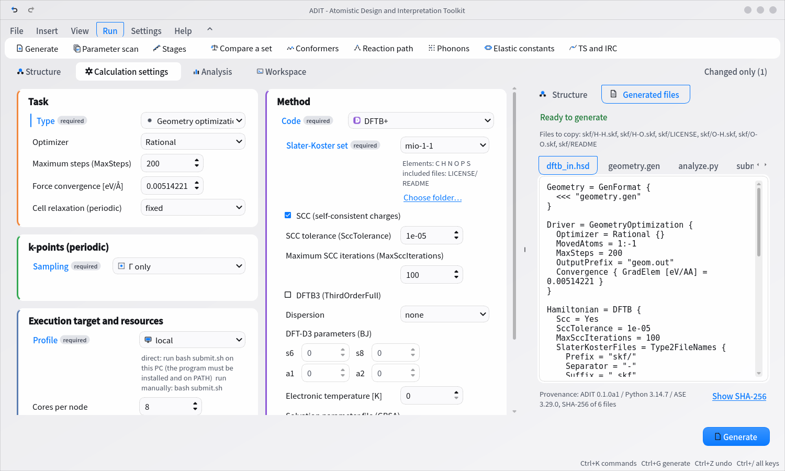

These are the conformer candidate and reaction path (NEB) screens.

| Conformer candidates | Reaction path (NEB) |
|---|---|
| 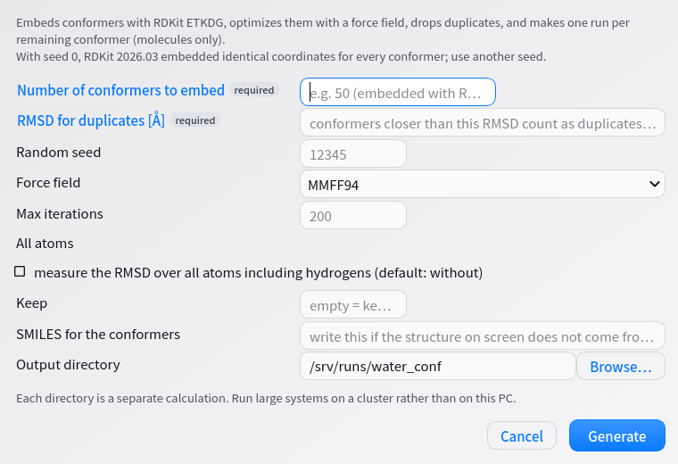 | 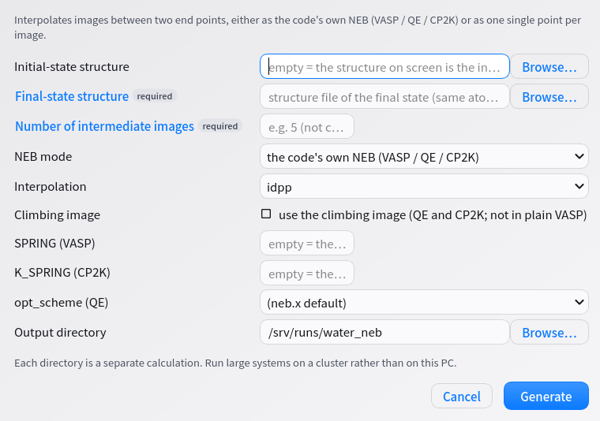 |

The "Batch generation" group under "Run" on the ribbon has six buttons. (In the web version, it is the collapsible "Batch generation" section; choose from the drop-down at the top.)
Each one **uses the current screen settings as they are** and changes only the fields in the table below. ADIT recommends no values (a field with a default uses the default of that code or package).

| What to build | Values to enter | After running |
|---|---|---|
| Set of runs to compare | The set kind (adsorption / reaction / solvation) and, for each calculation, the structure file, coefficient ν and charge. You can also give a `set.json` that defines the set | In analysis, enter that location as the base directory in "Compare runs" (it reads `compare.json`). On the CLI, `adit-analyze <out> --compare` |
| Conformer candidates | Number of conformers to make, RMSD for duplicates [Å] (required; no default), random seed, force field, number to keep | Open the directory in analysis for a table and plot of energies per conformer (`scan.json`) |
| Reaction path (NEB) | Final-state structure (required), number of intermediate images (required), mode (the code's NEB / a single point per image), interpolation, climbing image, SPRING, K_SPRING, opt_scheme | Open the directory in analysis for the energy curve and barrier (with a single point per image, a table and plot) |
| Phonons (finite displacements) | Supercell multiples (required), displacement size, how displacements are made (phonopy / ASE), DOS q-point mesh and width | Collect the forces with `python <out>/phonon_collect.py`, then open the directory in analysis |
| Elastic constants (strains) | Strain magnitudes (required; comma-separated), strain components (numbers in Voigt notation) | `python <out>/elastic_collect.py` collects the stresses and writes `elastic_constants.csv` |
| Transition state and IRC | What to generate (ORCA OptTS / IRC / both as stages, or an ASE + Sella script) | For ORCA, run each stage. For Sella, run `pip install ase sella <calculator package>`, then `bash submit.sh` |

After generating, ADIT shows the list of directories it made and "Next steps". If the output directory is not empty, ADIT asks for confirmation. It shows the number of files there and where the previous contents will be kept (`<output directory>/.adit_backup/<timestamp>/`).

**ORCA transition states and IRC** can also be set in the "Method" group. Setting "Transition-state search (OptTS)" with a geometry optimization task writes `! OptTS`. Setting "Follow the reaction path (IRC)" with a single-point task writes `! Freq IRC`. (There are also fields for the initial Hessian `Calc_Hess`, the recalculation interval `Recalc_Hess`, the final `Freq`, and the IRC iteration limit and direction.) To run both in turn, generate them as stages with "TS and IRC" in "Batch generation". (The form that combines them into one job has not been verified against the ORCA 6.1 manual.)

**Machine-learning potentials** are chosen from the code drop-down. Set the type (MACE-MP / MACE-OFF / CHGNet), model, device, dtype, D3 (mace_mp only) and random seed. Instead of an input file, `run_mlip.py` (ASE), `mlip_settings.json` and `structure.extxyz` are written, and one line on the screen shows the packages to install in the environment that runs the calculation (`pip install ase mace-torch` and so on). Total charge and spin multiplicity are not used (they stay at 0 and 1), and the k-points group does not appear.

**Values from the documents**: Below fields such as the cutoff, the values written in the parameter files you use appear in small text in the form "written in file name:line number: …" (the UPF and SSSP JSON for pw.x; ENMAX / ENMIN in the POTCAR for VASP; basis and pseudopotential annotations for CP2K; Hubbard derivatives, ζ, D3 coefficients and spinw.txt in the DFTB+ README). **These are not ADIT recommendations.** "Use" appears only when the unit matches the field, and the value enters the field only when you click it. If the documents say nothing, nothing appears.

On the command line (see `adit-gen --help` for the full syntax):

```bash
adit-gen spec.json out/ --compare-set set.json          # set of runs to compare (adsorption, reaction, solvation)
adit-gen spec.json out/ --conformers 50 --rmsd 0.5      # conformer candidates
adit-gen spec.json out/ --neb start.xyz end.xyz --images 5
adit-gen spec.json out/ --phonons 2x2x2                 # phonons (after running, python out/phonon_collect.py)
adit-gen spec.json out/ --elastic=-0.01,0.01            # elastic constants (after running, python out/elastic_collect.py)
adit-gen spec.json out/ --ts ts+irc                     # ORCA OptTS -> IRC as stages
adit-gen spec.json out/ --sella                         # ASE + Sella script (xtb, machine-learning potentials)
adit-gen spec.json --documented                         # list values from the documents, with sources
```

### Generate, run, analyze

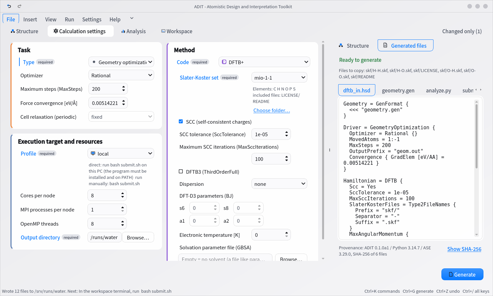

1. **Generate**: The output directory gets the input files, `submit.sh`, `spec.json`, `README.txt` and `analyze.py`. For a non-empty directory, ADIT asks before overwriting and shows how many of the files there will be overwritten, and under which names. Files to be overwritten are first copied to `<output directory>/.adit_backup/<timestamp>/`. For 10 seconds after generating, "Undo" on the status line restores the previous state (files that were added are removed).
2. **Run**: Run `bash submit.sh` in the Workspace terminal. For a cluster, transfer the files with the commands in `transfer_and_submit.sh` and submit with `qsub submit.sh` or `sbatch submit.sh`. The steps are also in `README.txt` in each directory.
3. **Analyze**: On the "Analysis" tab, give the run directory and click "Run analysis". The generated folder is already filled in.
4. **Play**: After analysis, "Play in 3D" below the summary gives a 3D view that animates the MD trajectory, the geometry optimization steps or the vibrational modes. Use the slider and the play and step buttons. A vertical line in the plot below (energy and temperature over time, or frequencies) follows the frame. Click the plot to jump to that frame (for vibrations, the nearest mode). See "Play in 3D" in [Analysis details](ANALYSIS.md).

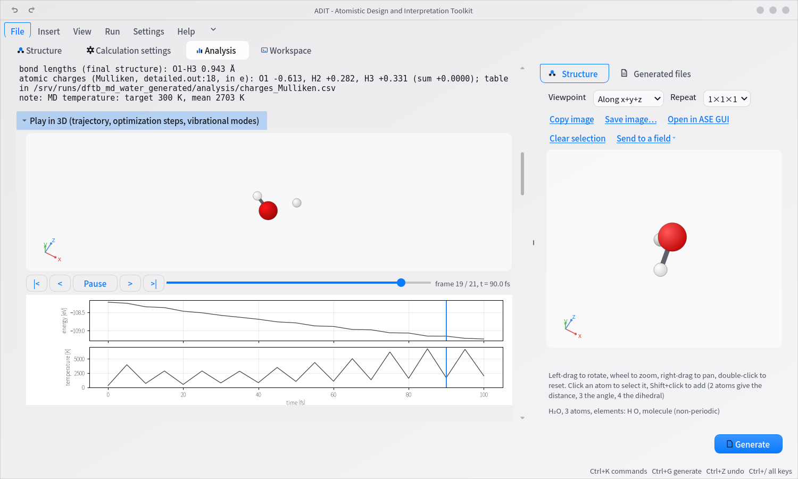

5. **Isosurface**: If the run directory has cube, CHGCAR, PARCHG, LOCPOT or CHG files, an "Isosurface" box appears below the summary. Choose a file to see its minimum and maximum values. Enter a level yourself and click "Draw the surface". The surface is drawn semi-transparently over the atoms (positive and negative in different colors; there is no default level). When there are too many triangles, ADIT suggests thinning them. See "Isosurface" in [Analysis details](ANALYSIS.md).

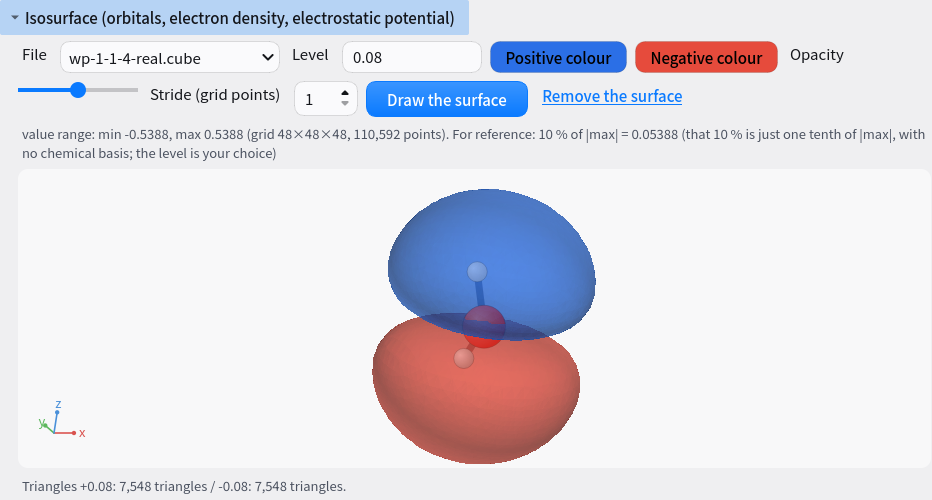

(The orbital in the picture above is a function made up to illustrate the screen, not a calculation result.)
