# Tutorial

This tutorial runs a geometry optimization of a water molecule from start to finish in the GUI. **It takes about 5 minutes.**
You type one command in a terminal, and only to start the calculation.

For installation, see [Installation on each OS](INSTALL.md).

---

## 1. Choose a structure

On the **Structure** tab, choose how to build the structure. Pick `H2O` from the presets, and a 3D view appears on the right.

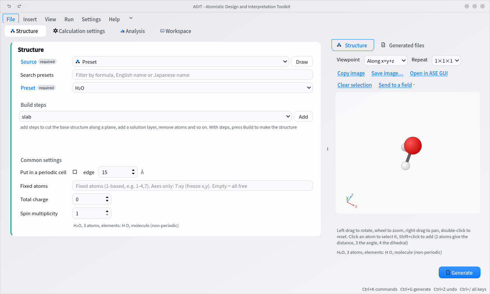

- Left-drag to rotate, use the wheel to zoom, and right-drag to pan
- The **Viewpoint** drop-down offers `along x`, `along y` and `along z`
- The arrows at the lower left of the frame are coordinate axes that rotate with the structure

## 2. Choose the calculation settings

On the **Calculation settings** tab, choose the code and the type of calculation. Here, that is DFTB+ and a geometry optimization.

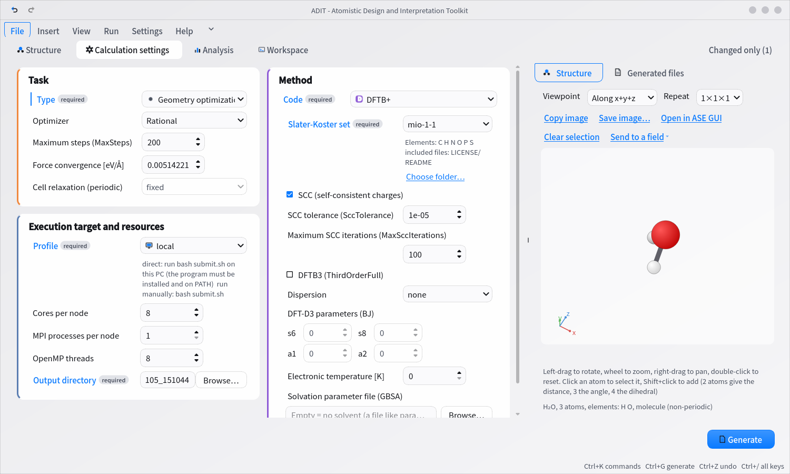

- **Fields tagged "required" must be filled in.** If one is empty, a red badge such as "1 issue" appears to the left of **Generate** at the lower right, and the reason appears in red under the field. (Click the badge to open the full list. Select a row to jump to that field.)
- The initial values are the code's own defaults. They are not values recommended by ADIT. A field changed from its default gets a thin blue line to the left of its label. (**Changed only** at the upper right shows just those fields.)
- Hover over a label to see a description of the field

## 3. Generate the input files

Click **Generate** at the lower right. The full set of input files is written to the folder you chose. You can check their contents in **Generated files** on the right.

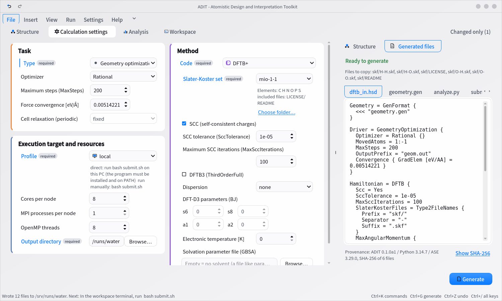

Files written:

| File | Contents |
|---|---|
| `dftb_in.hsd` and so on | Input for the code |
| `submit.sh` | Script that runs the calculation |
| `README.txt` | How to run the calculation (the end lists, with sources, the remedies that the code's documentation gives for failures) |
| `spec.json` | The settings you chose. Load it to regenerate the same input |
| `analyze.py` | Analysis script |
| `transfer_and_submit.sh` | Commands that send the files to a cluster and submit the job (cluster targets only) |

To run on a cluster, transfer this folder and run `bash submit.sh`.

## 4. Run the calculation

After you generate, the terminal on the **Workspace** tab moves to that folder. Type `bash submit.sh` there to start the calculation.
To run on a cluster, use the commands in `transfer_and_submit.sh`.

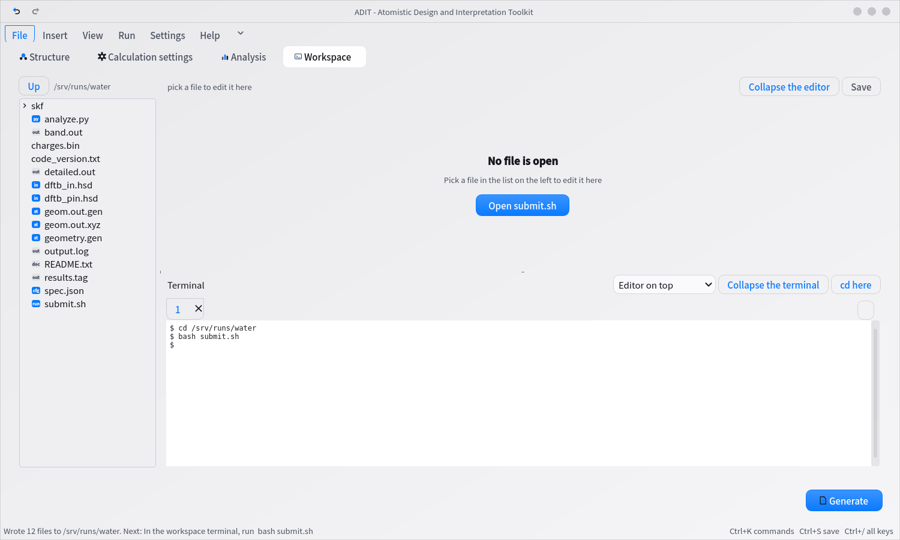

**ADIT never submits a job.** Even on this PC, a run starts only when you type `bash submit.sh` or pass `--run` to `adit-gen`.

## 5. Analyze the results

On the **Analysis** tab, the folder you ran is already filled in. Check the items you want and click **Run analysis**.

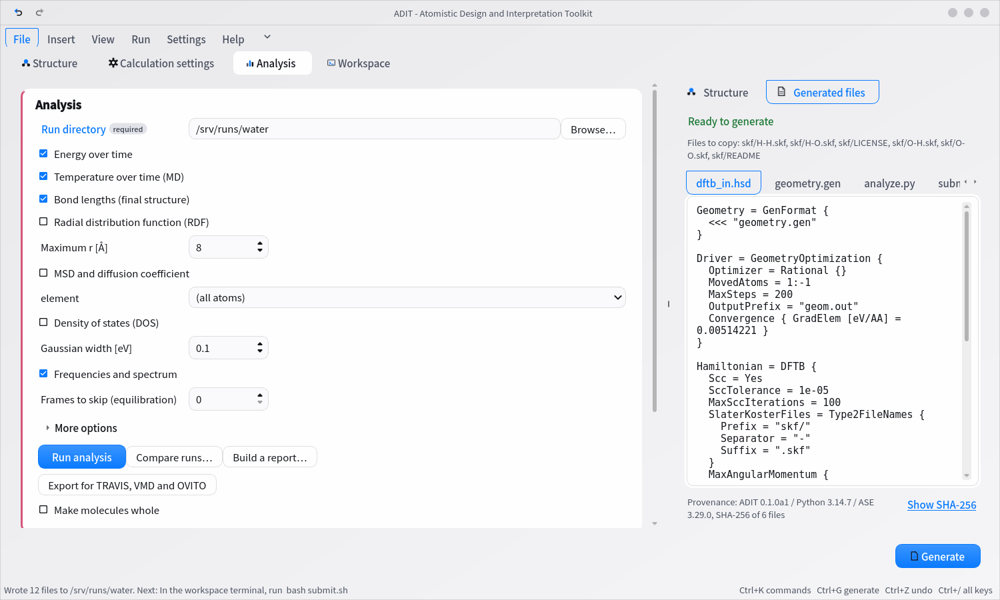

The summary, tables and plots appear below. You can copy a plot on the spot with **Copy image**, or export it with **Save image…**.

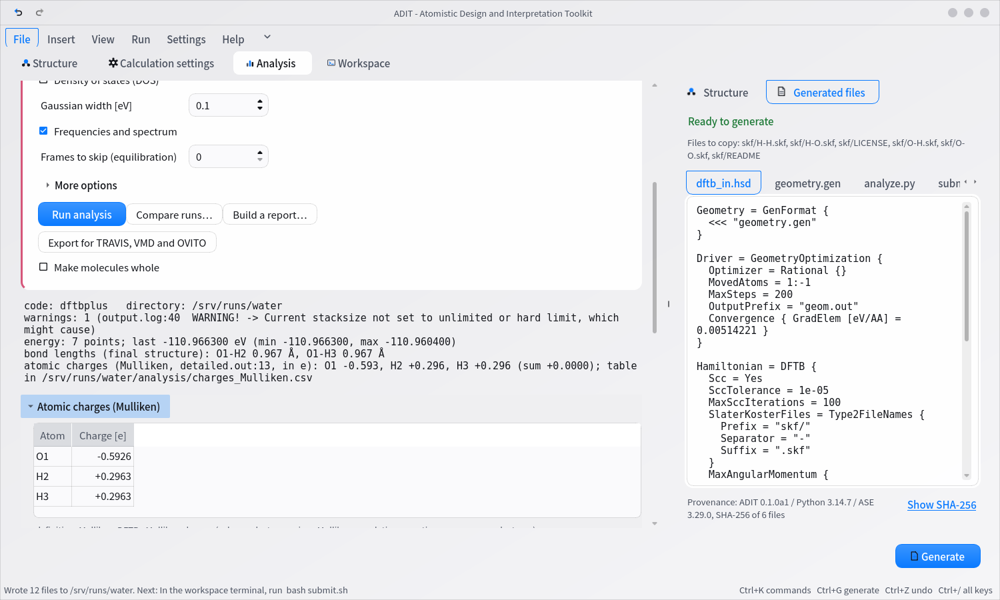

Each number comes with its unit and with the name and line number of the file it was read from.
For a calculation with a trajectory (MD or vibrations), **Play in 3D** below the summary animates the trajectory or the vibrational modes.

---

## Other ways to build a structure

**Bulk crystal**: Specify the element, crystal structure and lattice constant. You can also build surface slabs from here.

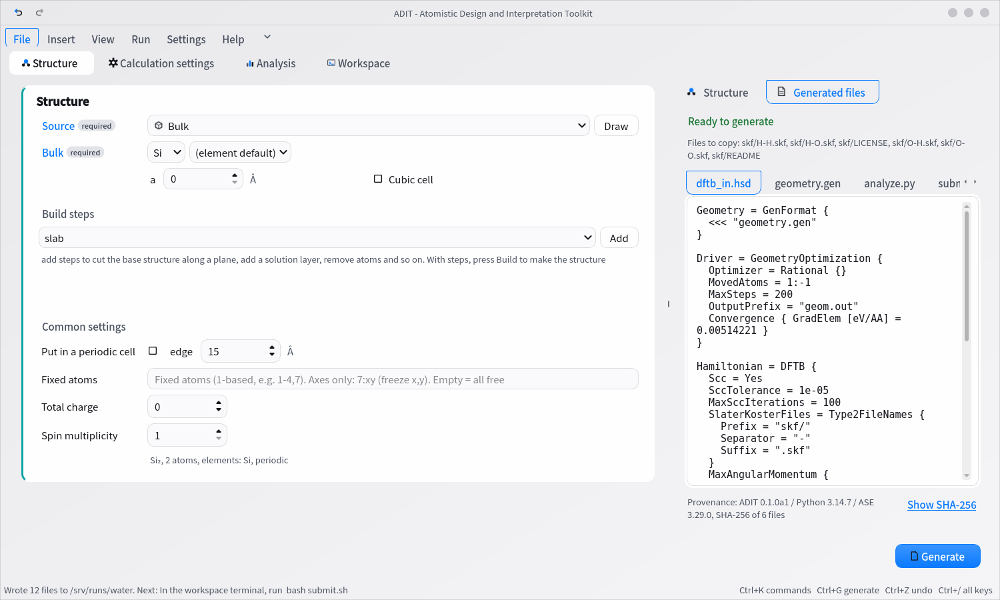

**Solution / mixture**: Specify the components, their counts and the density. ADIT builds a box packed with the molecules.

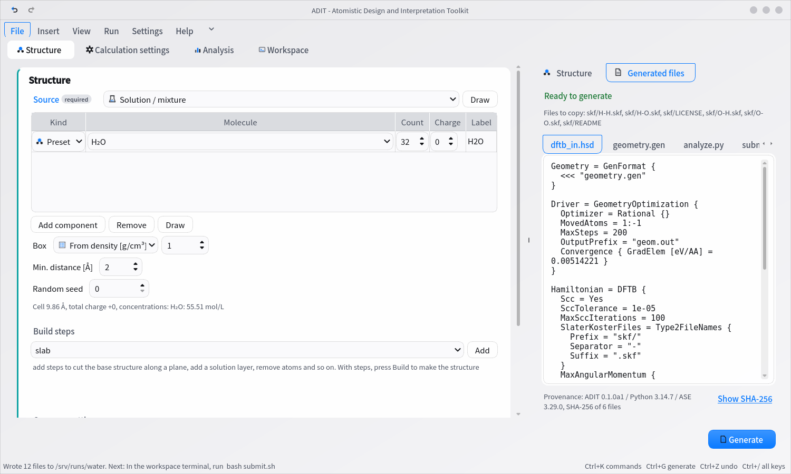

**Draw a molecule**: On the ribbon, choose **Insert** → **Draw**. You can use the molecule you draw directly as the structure. You can also load one from SMILES.

**Fetch from a database**: Set the structure's "Source" to "Fetch from a database". Choose PubChem (name or CID), COD (ID), Materials Project (mp-ID; needs `mp_api_key` in the preferences) or OPTIMADE (composition), enter the name or ID, and click "Fetch". ADIT goes online only at this point. If there are several candidates, choose one from the list. The provenance (source, ID, date and time, SHA-256 of the response, license) is kept in spec.json and README.txt, and the fetched file is also copied to the output directory. The terms for publishing or redistributing fetched data (COD is CC0; PubChem is public domain, though a provider may add its own terms; Materials Project is CC BY 4.0; OPTIMADE depends on the provider) are in the [Screen reference](SCREENS.md) and [THIRD_PARTY_NOTICES.md](../THIRD_PARTY_NOTICES.md).

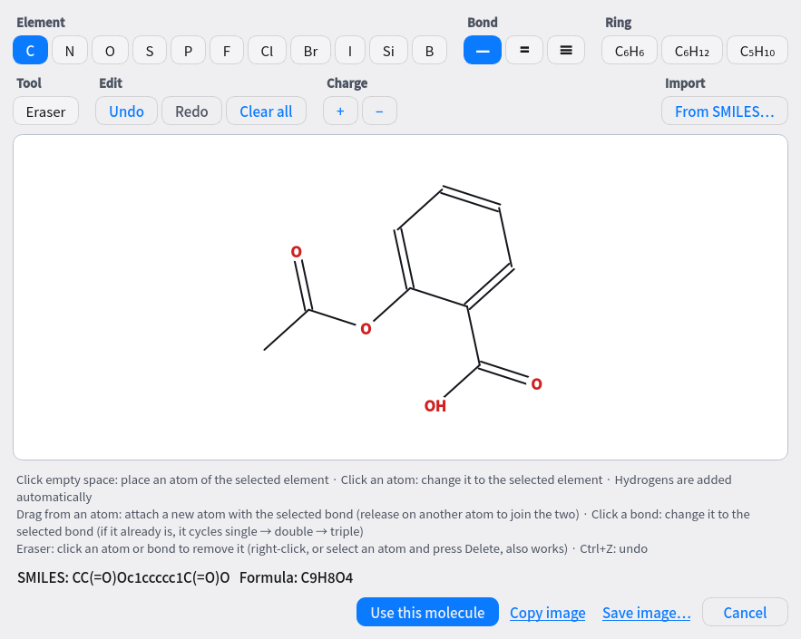

## Find things with the keyboard

If you cannot find an action or a field, press **Ctrl+K** and type its name. Actions (Generate, Generate a parameter scan, Load a group template…), the fields on the screen (temperature, ecutwfc, spin multiplicity…) and preset molecules (water, ethanol…) all appear in one search box. Press Enter to run the action or jump to the field. **Ctrl+/** opens the list of shortcuts.

## Generate many calculations at once

The **Run** tab on the ribbon has features that create several calculations at once.

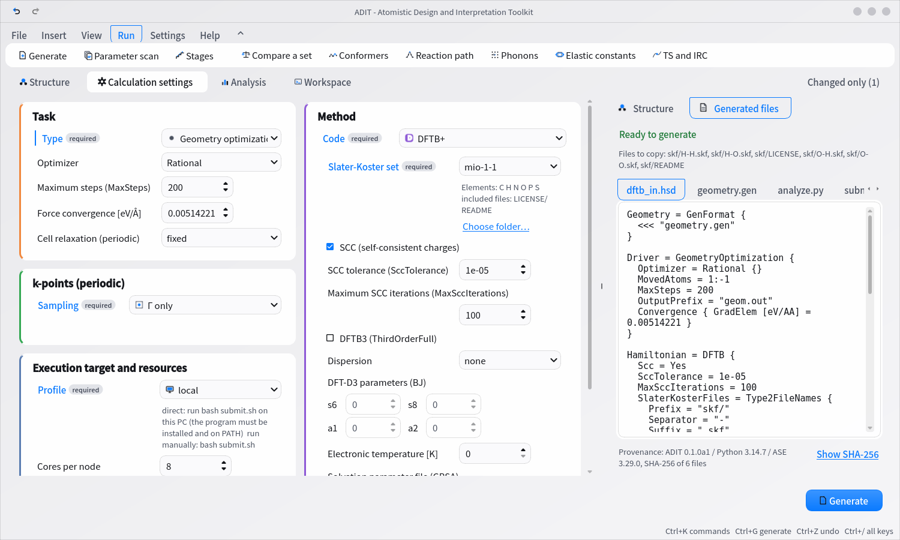

**Parameter scan** creates a series of calculations that differ in one value only (convergence tests for the cutoff or k-points, lattice constant searches).

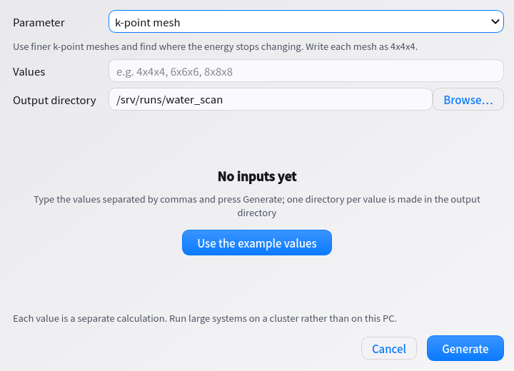

**Stages** creates calculations to run in sequence, such as minimization → NVT → NPT → production. The final structure of each stage is handed to the next stage automatically, just before that stage runs.

**Batch generation** covers sets to compare, conformer candidates, reaction paths (NEB), phonons, elastic constants, and transition states with IRC.

## Build a report

On the Analysis tab, click **Build a report…**. You can also specify several folders at once. You can export a methods section, a conditions table, a results table and a reproducibility bundle.

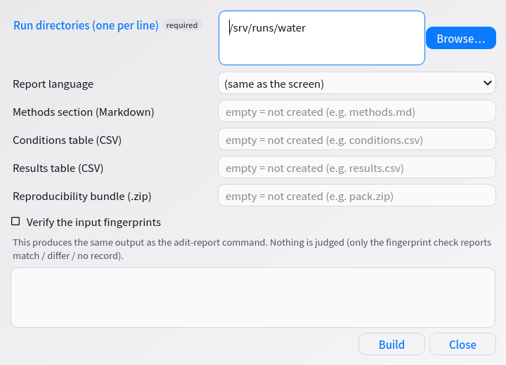

## Change how plots look

Open **More options** on the Analysis tab to set line colors, tick direction, grid lines and the axis frame. Use this to match a journal's requirements.

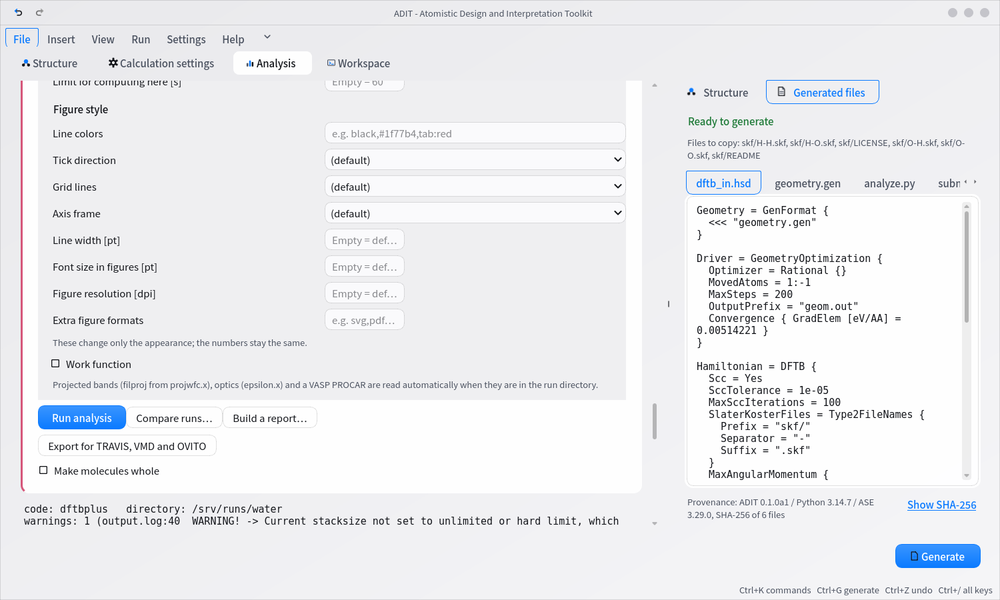

## Convert file formats

On the ribbon, choose **File** → **Convert**. It converts between structure file formats and converts settings between codes.

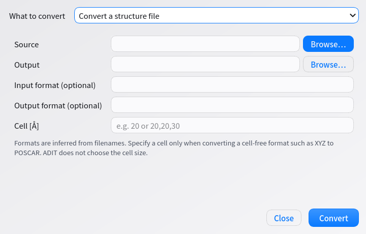

## Workspace: files, editor and terminal

The **Workspace** tab puts a file list, an editor and a terminal on one screen.
Without switching screens, you can fix input files, move files, or log in to a compute server with `ssh`.

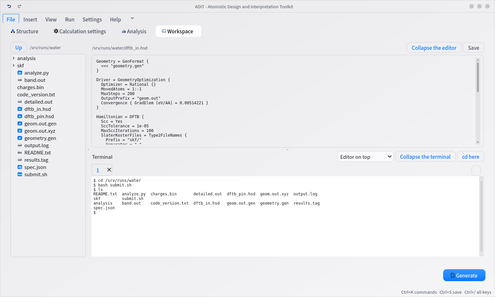

- **Tree on the left**: It opens three levels deep. A small mark on the left shows the file type
  (`in` input, `out` output, `st` structure, `cfg` settings, `run` run, `py` script).
  Double-click to open a file. The right-click menu has four items: "Open", "cd here in the terminal", "Rename…" and "New folder…"
- **Editor at the upper right**: It opens any text file (input files, `output.log`, notes). `Save` writes the file back
- **Terminal at the lower right**: Your local shell runs as is. Log in to a cluster with `ssh <user>@<cluster>`
  and paste the commands from `transfer_and_submit.sh`. You can do everything from transfer to submission here

What you can do in the terminal:

| Action | What it does |
|---|---|
| `+` button | Opens another terminal (one per cluster or per calculation, for example) |
| Drag | Selects a range. Right-click to copy or paste |
| `Ctrl+Shift+C` / `Ctrl+Shift+V` | Copy (the whole screen if nothing is selected) / paste |
| Wheel | Scrolls back through earlier lines (the scroll bar on the right does the same) |
| `Ctrl` + wheel, `Ctrl+±`, `Ctrl+0` | Changes the text size / resets it |
| Layout drop-down | Arranges the editor and terminal top and bottom or side by side (and can swap them) |
| "Collapse the editor", "Collapse the terminal" | Collapses one to give the other more room |
| `vim`, `htop` and so on | Work as is, with mouse support |

To change the shell, set the environment variable `ADIT_SHELL` (for example `ADIT_SHELL="bash --norc"`).

On Windows, PowerShell runs. On Linux and macOS, full-screen programs such as `vim` also work as is.

## Inspect inputs and results

On the ribbon, choose **File** → **Inspect inputs/results**. You can load inputs made by other software, check whether a generated input has been altered, and compare the settings of two calculations.
For details, see [Loading and checking existing inputs](NATIVE_INPUTS.md).

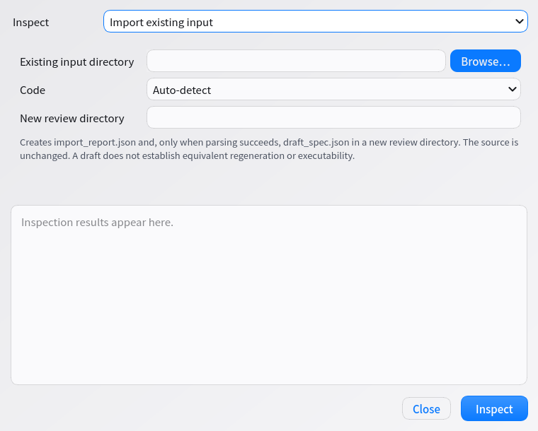

---

## From the command line

The same operations are available as commands. Use them to run many calculations automatically.

```bash
adit-gen --list-samples                       # list the bundled examples
adit-gen --sample water_generated mine.json   # copy one as your own settings file
adit-gen mine.json runs/water                 # write the full set of input files
adit-gen mine.json runs/water --run           # write them and run right away
adit-analyze runs/water --rdf --msd           # analyze and write plots and a summary
adit-report runs/*/ -o methods.md             # write a methods section
```

If the settings file has a key ADIT does not know (a typo, for example), it stops instead of silently falling back to the default. To proceed anyway, add `--ignore-unknown-keys`.
It also stops if the preferences file given to `--config` does not exist. (A new one is created at the default location only when you do not pass `--config`.)

Parameter scans and structure swaps look like this.

```bash
adit-gen mine.json out/ --scan method.ecutwfc=30,40,50    # vary one value
adit-gen mine.json out/ --structures "mols/*.xyz"         # swap only the structure, in bulk
adit-gen mine.json out/ --stages stages.json              # generate stages
```

To replace the structure with one fetched from a database, add `--fetch`. ADIT goes online only in this case. If there are several candidates, it lists them and stops.

```bash
adit-gen mine.json out/ --fetch pubchem:water             # PubChem name (for a CID, pubchem:962)
adit-gen mine.json out/ --fetch cod:1000041               # COD ID
adit-gen mine.json out/ --fetch mp:mp-149                 # Materials Project (needs mp_api_key in the preferences)
adit-gen mine.json out/ --fetch optimade:SiO2             # search across OPTIMADE providers -> list of candidates
adit-gen mine.json out/ --fetch optimade:oqmd:4061352     # the one candidate you chose
```

For the full list, run `adit-gen --help`. For analysis, run `adit-analyze --help-all`.
To call the parts from Python, see the [Python API](API.md).
